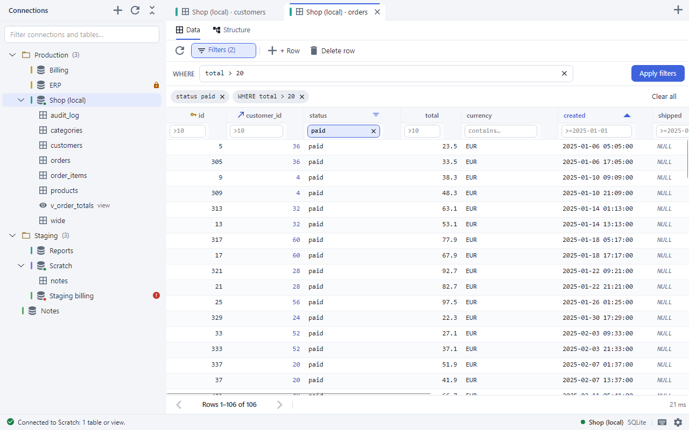
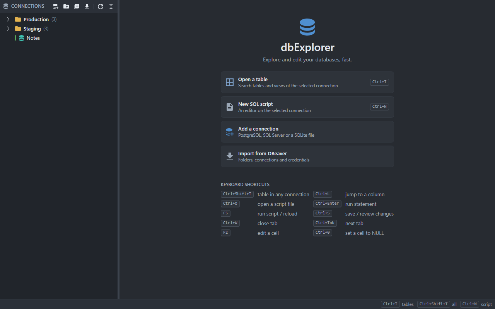

# dbExplorer

A lightweight Windows desktop app to explore and edit databases (PostgreSQL, SQL Server, SQLite) faster than DBeaver:
launch in about a quarter of a second, switch between connections instantly, jump to any table or column by typing its
name, follow foreign keys, filter and edit rows, run SQL scripts. .NET 10 + Avalonia 11, native ADO.NET drivers
(Npgsql, Microsoft.Data.SqlClient, Microsoft.Data.Sqlite), Windows only.

Design notes: [`docs/superpowers/specs/2026-11-20-dbexplorer-design.md`](docs/superpowers/specs/2026-11-20-dbexplorer-design.md).

## Screenshots

Light and dark follow Windows. More screens, and the design tokens: [`docs/ui/README.md`](docs/ui/README.md).

| Table tab (light) | Script tab (dark) |
| --- | --- |
|  |  |



## Features

- **Connection tree**: folders (one level) > connection > schema > table/view (SQLite has no schema level). Several
  connections stay connected at once, one session each. Drag a connection into a folder; add, rename, edit, delete.
  A **Groups** section at the top lists the linked database groups (see below).
- **Import from DBeaver**: folders, connections, credentials and virtual keys (see below).
- **Table tabs**, labelled `connection · table` with a colour chip per connection, each with two sub-tabs:
  - **Data**: pages of 200 rows (OFFSET paging), total row count only on demand (Count button), column sort,
    per-column filter row (`contains` by default, `=`, `!=`, `<`, `>`, `null`, `!null`, `in (a,b)`, combined with AND),
    "filter by this value" from the cell context menu, and a raw `WHERE` box. Filters run server-side with parameters.
  - **Structure**: columns, types, nullability, primary key, foreign keys, indexes.
- **Follow foreign keys**: `Ctrl+click` (or double-click) an FK value to open the referenced row in a new tab.
- **Quick open**: fuzzy-search tables/views of the active connection (`Ctrl+T`) or of all connections (`Ctrl+Shift+P`,
  served from an on-disk metadata cache, never connects by itself); `Ctrl+L` jumps to a column in the current table.
  The search forgives typos (a wrong, extra or missing letter, two letters swapped; from 4 letters on), exact matches
  rank first, and `Ctrl+T` reopens with the text you typed last time, selected (type to replace it, Enter to reuse it).
- **Row editing**: edits are staged in the grid (highlighted), `Ctrl+S` shows the generated SQL, then applies it in one
  transaction. Insert and delete rows. Tables without a primary key are read-only until you define "virtual key"
  columns for them (persisted, like DBeaver's virtual PK). Edit is disabled on connections flagged read-only.
- **Script runner**: a SQL editor tab per connection (AvaloniaEdit, syntax highlighting). `F5` runs the whole script,
  split on `;` (respecting quotes, comments and `$$` bodies) and on `GO` lines for SQL Server. `Ctrl+Enter` with nothing
  selected runs the statement under the cursor, which also ends at a **blank line** (outside strings, comments and `$$`
  bodies; T-SQL needs no `;`), so a SELECT followed by a blank line and an UPDATE never run together; a cursor on a blank
  line runs the statement above it. A selection runs as selected (split by `;`/`GO` only). One result grid per result
  set, rows affected and duration, cancel button, and a "Rows" limit box (default 1000, up to 100 000): a result cut at
  the limit says so, raise the limit and run again. Honours the connection read-only flag. Scripts are plain files;
  unsaved editor contents are restored at the next start.
- **One connection per script tab**: the tab opens its own connection on its first run and keeps it, so `BEGIN TRAN`,
  temp tables (`#t`), variables and `SET` options survive from one run to the next, and `ROLLBACK`/`COMMIT` in a later run
  works. It is released when the tab closes (a transaction still open is rolled back), on Disconnect, when the connection
  is edited, or when it is found broken; the next run then reconnects and the status bar says the session state was reset.
- **Linked database groups**: link databases that share one schema (dev, preprod, customer copies) into a named group, switch
  a tab between them with one key press, run the same read-only query on all of them at once and see where the results
  differ, or compare their schemas. Details, shortcuts and limits: [Linked database groups](#linked-database-groups).
- **Safety**: nothing is written without an explicit save; passwords are stored encrypted with Windows DPAPI (current
  user); SQL Server connections expose `encrypt` and `trustServerCertificate`.
- Light/dark theme follows Windows.

## Linked database groups

A **group** is a named, ordered list of connections that have the same schema and the **same engine** (all PostgreSQL, all SQL
Server or all SQLite). It only references connections: credentials and the read-only flag stay on each connection, a
connection can be in several groups, and deleting a connection removes it from its groups. Groups are stored in `config.json`
(an older file without groups loads unchanged).

**In the navigator.** The **Groups** section (it appears once a group exists) lists each group with its engine and member
count; a group expands to its members, which are shortcuts to the real connections (double-click connects one). Create a group
with the **New group** button of the navigator toolbar or from a group's menu; a connection's menu has **Add to group...**
(one of the groups it could join, or a new group started with it). A group's menu: **Check schema differences**, **Edit
group...**, **Rename...**, **Delete group** (the connections are kept) and **New group...**; a member's menu: **Connect** and
**Remove from group**.

**Group editor.** A name plus two lists: the available connections and the members in order (add, remove, move up / down;
double-click moves an entry). The first member fixes the engine, and only connections of that engine are offered afterwards.
Saving is refused for an empty or duplicate name. A group with fewer than two members can be saved (a banner says it needs two
to switch or compare); it just has no selector and no run on group.

**Schema-difference report** (group menu, **Check schema differences**). Connects to every member (4 at a time, with the
status-bar spinner and Cancel), reads their schemas and shows, for each database against the rest of the group: missing and
extra tables / views, missing and extra columns, columns whose data type differs, and an object that is a table in some
databases and a view in others. Indexes, keys and constraints are not compared. A database that cannot be reached is listed
in the report and never stops the others. Informational only; the connections it opened stay open in the navigator.

**Switching a tab between members.** A table or script tab whose connection is in a group with other members shows a database
selector (group icon, previous / next chevrons and a list of the group's databases; a group picker too when the connection is
in several groups). `Ctrl+Alt+PageDown` / `Ctrl+Alt+PageUp` move to the next / previous database of the group, wrapping around.

- A **table tab** reloads the same table on the other database with the same filters, raw `WHERE` and sort, from page 0.
  Pending edits go through the usual Save / Discard / Cancel question first. If the other database cannot be reached or has no
  such table, an error strip says so and the tab stays exactly as it was (edits you chose to discard stay discarded).
- A **script tab** keeps its text and its results; the next run uses the other database. Its own dedicated connection to the
  old database is released at the switch, so a transaction left open there is rolled back (as when the tab closes).
- A switch is refused while a script or a group run is running in that tab.

**Run on group** (script tab on a connection that is in a group; the "Run on group" and "Script on group" buttons only show
then). `Ctrl+Shift+Enter` runs the selection or the statement under the cursor (same rules as `Ctrl+Enter`), `Ctrl+Shift+F5`
the whole script, on every database of the group at the same time (4 at a time, not configurable), with the tab's row limit
applied per database. A status panel lists every database as waiting, running, done (rows and time), failed (with its error)
or cancelled, with a Cancel button on each line and **Cancel all** (`Ctrl+Break` too). One slow, unreachable or failing
database never blocks the others. The results:

- **All**: the rows of every database in one grid with a leading `Database` column, merged on the columns that all databases
  have (a notice names the columns that were left out).
- **Differences only** (check box on the All tab): only the rows that are not identical in every database, with a leading
  `Present in` column naming the databases that have the row (`name×2` when a database has it twice). Rows are compared on all
  their values, NULLs included; numbers, dates and GUIDs are compared by value across engines.
- **One tab per database**: that database's own result grid (or its error) for the compared statement.
- A database that failed, was cancelled or returned no columns is left out of All and Differences and named in a notice. A
  result cut at the row limit says so, and warns that the differences may then be false.

**Read-only guarantee.** A group run is read and compare only. Every statement goes through the engine-aware read-only guard
and every database runs in a read-only context, **whatever the read-only flag of each connection says**: a connection that is
editable on its own is still read-only in a group run. It is exactly as strong as the read-only mode of an ordinary connection
(see Known limitations: a lexical guard that does not know functions with side effects, plus a database-enforced read-only
context on PostgreSQL and SQLite and a rolled-back transaction on SQL Server). A write statement (or anything the guard cannot prove to be a read)
refuses the whole run for all databases with "Group runs are read-only; run writes on one database at a time". This check
runs first, before the app starts resolving any member's session, and the runner repeats it as its own guard before it opens
a connection. Other refusals are reported the same way: an empty script, or a run, a switch or a reconnect already in
progress, are also caught before any session is touched; a group whose databases are of different engines (only possible
with a hand-edited `config.json`) is refused by the runner, after the app has started resolving the members' sessions
(connecting the ones that are not connected in the navigator) but before any group connection is opened or any statement runs.

**Limitations.**

- Groups are same-engine only (enforced when editing a group). Changing the engine of a connection that is in a group is
  refused: remove it from its groups first.
- The fan-out is read-only: no write, DDL or migration on several databases at once, no data sync, no row-level table diff.
- Each group run opens **one fresh dedicated connection per database** and closes it when that database is done. It never
  uses the script tab's own connection, so a `BEGIN TRAN` or a temp table of an ordinary run is neither seen nor disturbed.
- There is **no automatic timeout** on a statement: a slow query keeps running until it ends or you cancel it (the line's
  Cancel button, or Cancel all). Only connecting gives up on its own (10 s on PostgreSQL and SQL Server).
- For a whole script (`Ctrl+Shift+F5`), All and Differences compare only the **last statement that returned rows**, and the
  per-database tabs show only that same statement (a notice says which of the N statements it is). To compare another
  statement, run it alone with `Ctrl+Shift+Enter`.
- While a group run is active, an ordinary run, a database switch and a second group run are refused in that tab.
- Results are kept in memory: the row limit applies per database (default 1000, up to 100 000).

## Keyboard shortcuts

| Shortcut | Where | Action |
| --- | --- | --- |
| `Ctrl+T` | anywhere | Quick open a table/view of the active connection |
| `Ctrl+Shift+P` | anywhere | Quick open a table/view across all connections (metadata cache) |
| `Ctrl+Shift+T` | anywhere | Reopen the last closed tab (like a browser; press again to go further back; up to 50 are remembered; a table keeps its filters, a script its text) |
| `Ctrl+L` | table tab | Fuzzy-search a column and scroll to it |
| `Ctrl+N` | anywhere | New script tab on the active (or selected) connection |
| `Ctrl+O` | anywhere | Open a script file in a script tab |
| `Ctrl+Enter` | script tab | Run the statement under the cursor (ends at `;`, a `GO` line or a blank line) or the selection |
| `F5` | script tab | Run the whole script; in a table tab: reload the data |
| `Ctrl+Shift+Enter` | script tab on a connection in a group | Run the statement under the cursor / the selection on **every database of the group** (read-only, see [Linked database groups](#linked-database-groups)); in a script tab that is not in a group the status bar only says so (no ordinary run) |
| `Ctrl+Shift+F5` | script tab on a connection in a group | Run the whole script on every database of the group (read-only) |
| `Ctrl+S` | script tab / table tab | Save the script to a file / review the SQL and apply staged edits |
| `Ctrl+W` | anywhere | Close the active tab |
| `Ctrl+Tab` | anywhere | Next tab |
| `Ctrl+Shift+Tab` | anywhere | Previous tab |
| `Ctrl+Alt+PageDown` | table / script tab on a connection in a group | Switch the tab to the next database of the group (wraps around) |
| `Ctrl+Alt+PageUp` | table / script tab on a connection in a group | Switch the tab to the previous database of the group (wraps around; with several groups, the group picked in the selector) |
| `Esc` | quick open overlay | Close the overlay |
| `Esc` | table tab | Discard staged edits: specified in the design, **not wired yet** (use the Revert button; in a cell editor Esc cancels that edit) |
| `Ctrl+0` | table grid, cell selected | Set the cell to NULL (staged) |
| `Ctrl+Break` | script tab | Cancel the running query, or the running group run (all databases) |
| `F2` | table grid | Edit the cell |

## Build, test, publish

Requirements: Windows 10/11, the .NET 10 SDK, and PowerShell 7 (`pwsh`) to run `publish.ps1` and `scripts\measure-startup.ps1`
(they will not run in Windows PowerShell 5.1).

```powershell
dotnet build DbExplorer.sln -c Release
dotnet test  DbExplorer.sln                 # 980+ tests; DB integration tests are skipped unless configured, see below
dotnet run --project src/DbExplorer.App -c Release
```

Fastest-launching build, into `dist\`:

```powershell
.\publish.ps1                      # self-contained, ReadyToRun composite, ~160 MB, launches in ~0.26 s
.\publish.ps1 -FrameworkDependent  # ~57 MB, needs the .NET 10 runtime, launches in ~0.32 s
```

`publish.ps1` cleans `dist\` and the `obj\` folders, publishes `win-x64`, prints the exe path and size, then launches the
published exe 5 times against a throw-away data dir and prints the startup numbers (use `-Runs N` for more).
Do not enable trimming: Avalonia bindings and the database providers use reflection.

## Configuration and data

Everything lives in `%APPDATA%\dbExplorer`:

| Path | Content |
| --- | --- |
| `config.json` | folders, connections (passwords DPAPI-encrypted for the current Windows user), virtual keys, linked groups |
| `cache\` | per-connection metadata cache (schema/table/column names) used by `Ctrl+Shift+P` |
| `scripts\` | unsaved script tabs, restored at the next start |
| `window.json` | size, position and maximised state of the main window |

A corrupt `config.json` is moved to `config.json.bad-<timestamp>` and the app starts empty with a notice. If the file
cannot be read at all (locked, unreadable) the app starts in read-only-config mode: a red banner says so and nothing is
ever written to it.

### Command line and environment

| Option | Environment variable | Meaning |
| --- | --- | --- |
| `--data-dir <path>` | `DBEXPLORER_DATA_DIR` | Use this folder instead of `%APPDATA%\dbExplorer` |
| `--dbeaver-dir <path>` | `DBEXPLORER_DBEAVER_DIR` | DBeaver config folder for the import. When only the data dir is overridden it defaults to `<data dir>\dbeaver`, never the real workspace |
| | `DBEXPLORER_RENDERING=gpu` | Use Avalonia's default GPU/ANGLE rendering instead of software rendering (see Startup performance) |

A flag without a value is reported in a message box and the app exits (exit code 2). The flags win over the environment
variables.

## Importing from DBeaver

Click **Import** in the navigator toolbar. It reads `%APPDATA%\DBeaverData\workspace6\General\.dbeaver\data-sources.json`
and `credentials-config.json` (or the `--dbeaver-dir` folder): folders, connections, credentials (re-stored DPAPI-encrypted)
and virtual keys. It is a one-time, re-runnable action: connections whose name already exists are skipped, and the live
config is replaced only when the whole import succeeded. Warnings (unsupported drivers, missing credentials) are listed
in the status bar. Only user/password authentication is imported.

Connections that DBeaver marks `read-only`, or whose connection type is `prod` / `production` (or a custom type with
"prod" in its name or one that forbids data edits), are imported **read-only**, on purpose: an imported production database
never silently becomes editable. The status bar names them after the import; untick **Read-only** in the connection's
context menu to edit one. Virtual keys that use "all columns" skip the columns SQL Server / PostgreSQL cannot compare
with `=` (text, ntext, image, xml, json...).

## Integration tests against real databases

The unit tests use fakes and SQLite. The Postgres and SQL Server driver tests also have integration variants that are
skipped unless an environment variable holds a connection string to a scratch database. They create uniquely named
throw-away schemas and drop them afterwards, but do not point them at a database you care about.

```powershell
$env:DBX_PG    = 'Host=localhost;Port=5432;Database=scratch;Username=postgres;Password=...'   # Npgsql connection string, PostgreSQL 11+
$env:DBX_MSSQL = 'Server=localhost;Database=scratch;User Id=sa;Password=...;TrustServerCertificate=True'   # ADO.NET connection string
dotnet test tests/DbExplorer.Core.Tests
```

## Startup performance

The pass/fail bar from the design is a usable window in under about 1 s. Measured on the dev machine (Windows 11,
Release, win-x64) with `scripts\measure-startup.ps1`: it launches the exe with a throw-away `--data-dir` holding a
synthetic 8-connection config, polls the process's own top-level windows until one is visible (no input is ever sent),
reads the working set 3 s later, kills the process. Times are process start to main window visible. A trace inside the
app showed the first painted frame lands about 55 ms after that moment. Median of 10 warm launches.

| Build | Warm median (min-max) | First launch of a fresh build ("cold") | Working set |
| --- | --- | --- | --- |
| Baseline: framework-dependent, JIT (the build before this work) | 716 ms (704-833) | 4 037 ms (2 315 for a fresh publish of the same code) | 89 MB |
| + ReadyToRun (app and all dependencies) | 430 ms (415-443) | 1 343 ms | 82 MB |
| + config load on a worker thread | ~385 ms | ~1 350 ms | 77-82 MB |
| + ReadyToRun composite, framework-dependent | ~325 ms (316-336) | 4 085-4 204 ms | 82 MB |
| **+ ReadyToRun composite, self-contained (published default)** | **260 ms (256-290)** | **3 747-8 730 ms** | **84 MB** |

The warm column is the one that matters day to day. The "cold" column is the very first launch after a build or publish
(a new copy of the files); it is dominated by Windows Defender's one-time scan of the new files, not by our code, and
**the composite images make it worse** (about 4-9 s instead of 1.3 s with plain ReadyToRun: the composite image is one
large new file, 24 MB framework-dependent, ~100 MB self-contained). It happens once per publish, and `publish.ps1`'s own
measurement launch absorbs it, so the first launch you do yourself is already a warm one. A true cold start after a
reboot (file cache empty, Defender already done) could not be measured without administrator tools (RAMMap), so the
"under 1 s from a cold disk" bar is verified for warm launches only. If a slow first launch after each publish matters
more than 60 ms per launch, publish with plain ReadyToRun instead (remove `PublishReadyToRunComposite`).
What was tried, and what was kept:

- **ReadyToRun: kept.** The biggest win (716 to 430 ms): the app's own code is no longer JIT-ed (0 of the ~2600 JIT-ed
  methods were ours; they are Avalonia generics and P/Invoke stubs).
- **ReadyToRun composite: kept.** Putting app, Avalonia and the dependencies in one image lets the compiler precompile
  Avalonia's generic instantiations over its own types: JIT-ed methods 2609 to ~1200, about 385 to ~330 ms (A/B on the same
  build, measured before the worker-thread config load).
- **Self-contained (with the runtime in the composite): kept as the publish default.** A further ~65 ms (325 to 260 ms)
  for 160 MB of disk instead of 57 MB; `-FrameworkDependent` is the small alternative.
- **Config load on a worker thread: kept.** Overlaps the ~45 ms config read with Avalonia's ~90 ms platform setup
  (428 to 385 ms). Warming Avalonia control types on a worker thread was tried and rejected: their static constructors
  need platform services of the UI thread (`TypeInitializationException`, process crash).
- **Tiered compilation settings: no effect, left as is.** `TieredPGO=false` and `TieredCompilationQuickJitForLoops=true`
  (already in the csproj) are neutral at startup (PGO on: 430 ms, off: 430 ms); `TieredCompilation=0` is slower
  (589 ms), `TC_QuickJitForLoops=0` is slower (493 ms), `gcConcurrent=0` and a 64 MB gen0 budget do not help.
- **Rendering: software kept as the default.** GPU/ANGLE (`DBEXPLORER_RENDERING=gpu`) starts ~100 ms later (367 ms vs
  260 ms) and uses about 80 MB more RAM (164 MB vs 84 MB). Scrolling a 200 row x 20 column grid by script (360 frames,
  rows and columns) was the same in both: mean frame 17.0 ms software vs 17.7 ms GPU, p95 ~30 ms in both, so the frame
  time is UI-thread layout, not painting.
- **Avalonia/runtime options: rejected, no measurable gain.** `UseWin32().UseSkia()` instead of `UsePlatformDetect()`,
  an explicit default font, `RedirectionSurface` composition only, `InvariantGlobalization`, `UseNls`. There is no custom
  font or `WithInterFont` (the system font is used).
- **Provider assemblies:** Npgsql and Microsoft.Data.SqlClient are not loaded at startup (checked from the loaded-assembly
  list); they load on the first connection of that kind.
- **Linked groups, reopen-closed-tab and fuzzy search: nothing runs before the first paint.** Groups are a few lines of the
  small `config.json` read on the worker thread; the Groups section of the tree is built in memory from it (no I/O, no
  database), and the run, switch, schema-check, reopen and quick-open code only runs on a command. A/B of the published exe
  against the build before this work, interleaved on the same (noisier than above) machine: 316 / 318 ms vs 303 / 323 ms.
- **Trimming / single-file: not used** (Avalonia bindings and the providers use reflection, and it did not look necessary).

## Known limitations

- Large object columns (text, binary) are fully materialised for each 200-row page.
- Linked groups: same-engine only, read-only fan-out, no automatic statement timeout, whole-script runs compare only the last
  row-returning statement (details in [Linked database groups](#linked-database-groups)).
- A lexical guard that does not know functions with side effects: the read-only guard (ordinary read-only connections, the raw
  WHERE box and group runs) looks at tokens, not at what a function does. It refuses a fixed deny-list, matched by exact name
  when followed by ( (schema-qualified and double-quoted forms included): PostgreSQL server control (pg_terminate_backend,
  pg_cancel_backend, pg_reload_conf, pg_switch_wal, ...), statistics resets (pg_stat_reset*), session-level advisory
  locks (pg_advisory_lock*, pg_try_advisory_lock*), dblink*, server-side files (lo_export, pg_file_*), replication slot
  functions, and on SQL Server OPENQUERY / OPENROWSET / OPENDATASOURCE and NEXT VALUE FOR. Any other function with side
  effects (a user-defined function that writes, 
extval / setval, ...) is not detected; on PostgreSQL and SQLite the database's
  own read-only context still refuses most of them, on SQL Server nothing but the rolled-back transaction does. Obfuscated
  forms (dynamic SQL built inside a function, aliases, a function reached through a view) are an accepted gap.
- No background schema refresh: the schema and the metadata cache behind `Ctrl+Shift+P` are reloaded when a connection is
  (re)opened or on the tree's Refresh action, never while a connection just stays open.
- SQL Server read-only mode is a statement guard plus a rolled-back transaction, not a database-enforced read-only session.
  PostgreSQL uses a `READ ONLY` transaction. SQLite read-only is enforced by the database: the file is opened read-only
  (SQLite is not pooled, so toggling the flag applies to the next connection opened, and a script tab reconnects at its
  next run) and scripts also set `PRAGMA query_only`.
- One connection per script tab: a transaction left open (`BEGIN TRAN` without `COMMIT`/`ROLLBACK`) keeps its locks until
  you finish it or close the tab, which rolls it back (an explicit rollback is sent on SQL Server and PostgreSQL). Table
  tabs, the tree and edits use other connections: they do not see an uncommitted change, and on SQL Server (default READ
  COMMITTED) a table tab reading rows that the open transaction has locked may wait until you `COMMIT` or `ROLLBACK`. There
  is no "transaction open" indicator (it cannot be detected reliably across the three engines). After a cancelled statement
  the next run waits for it to stop first.
- `Ctrl+Enter` ends a statement at `;`, a `GO` line or a blank line: a statement with a blank line inside it (a long
  `CREATE PROCEDURE`) is cut there; select it and press `Ctrl+Enter`, or use `F5`. One exception: an `UPDATE` / `DELETE`
  with no `WHERE` of its own followed, after a blank line, by a segment starting with `WHERE` runs as one statement.
- Toggling **Read-only** on a connection only takes effect on a script tab's connection at its next run, so a user
  transaction left open there keeps its locks until then (or until the tab closes).
- A result cut at the row limit cancels its command; on PostgreSQL that can abort an open transaction. The run then
  reports "connection was reset ... any open transaction was aborted and rolled back" at once (a probe runs at the end of a
  cancelled or truncated run) instead of a later `COMMIT` silently doing nothing.
- Date/time parameters are bound with the exact column type (SQL Server `datetime2(n)`, PostgreSQL `timestamptz` as UTC);
  this is covered by unit tests on the parameter objects only, not yet confirmed against real servers (see the integration
  tests below).
- The PostgreSQL and SQL Server code paths are only validated by unit tests with fakes unless the integration tests above
  are run against real servers.
- Authentication is user/password only (no Windows integrated or Azure AD), no SSH tunnels, no MySQL/Oracle, no DDL
  editing, ER diagrams or export wizards.
