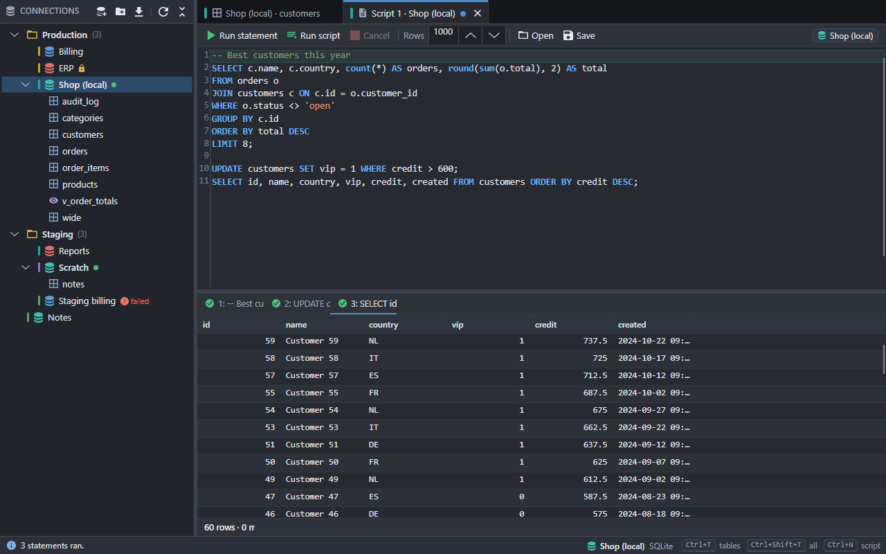

# dbExplorer

A fast, lightweight Windows app to explore and edit PostgreSQL, SQL Server and SQLite databases. It opens in about a
quarter of a second, switches between connections instantly, and jumps to any table or column as you type its name.


| Script editor (dark) | Execution plan (dark) |
| --- | --- |
|  |  |

Light and dark follow Windows. More screens and the design rules: [`docs/ui/README.md`](docs/ui/README.md).

## Install

Windows 10/11, one line in PowerShell (Windows PowerShell 5.1 or PowerShell 7). No admin rights, no .NET, no GitHub CLI.

```powershell
irm https://raw.githubusercontent.com/JonathanOll/dbExplorer/main/install.ps1 | iex
```

- **Update**: run the same line again. The app also updates itself in the background.
- **Uninstall**: Settings > Apps > dbExplorer, or
  `powershell -NoProfile -ExecutionPolicy Bypass -File "$env:LOCALAPPDATA\Programs\dbExplorer-setup\install.ps1" -Uninstall`.
- **With options** (version, desktop shortcut, launch at the end):
  `& ([scriptblock]::Create((irm https://raw.githubusercontent.com/JonathanOll/dbExplorer/main/install.ps1))) -Version 1.0.4 -DesktopShortcut -Launch`
- **TLS error on a bare Windows PowerShell 5.1**: run
  `[Net.ServicePointManager]::SecurityProtocol=[Net.SecurityProtocolType]::Tls12;` before the `irm` command.

All switches, install locations, GitHub rate limit (`$env:GITHUB_TOKEN`) and manual or offline install: [docs/install.md](docs/install.md).

## Highlights

- **Explore and edit data**: connection tree with folders, table tabs with paging, per-column filters and a raw `WHERE`,
  follow foreign keys with `Ctrl+click`, staged row editing applied in one transaction, and tabs restored at the next start.
  [Features](docs/features.md)
- **Command palette** (`Ctrl+Shift+K`): every command of the app, searchable, with the reason when one is not available.
- **Copy and export**: select rows, cells or columns; copy as CSV, JSON, Markdown, SQL or an `IN` list; export to CSV,
  TSV, JSON, XLSX, SQL or Markdown, the whole query streamed to disk. [Copy and export](docs/export.md)
- **Quick open**: fuzzy search of tables, views, procedures, functions and columns, on one connection or across all of them,
  forgiving typos.
- **Views and routines**: browse views, procedures and functions in the navigator and open their definition as text.
  [Features](docs/features.md#quick-open)
- **Linked database groups**: group databases that share a schema, switch a tab between them with one key, run a read-only
  query on all of them and see where the results differ, or compare their schemas. [Groups](docs/groups.md)
- **Script editor**: syntax highlighting, run a statement, a selection or the whole script, one result grid per result set,
  one connection per tab so transactions and temp tables survive between runs.
  [Features](docs/features.md#script-runner)
- **Script library, query history, formatting, search**: your `.sql` files in real folders, every statement you ran, a safe
  SQL formatter, and one search over scripts and data. [Scripts](docs/scripts.md)
- **ER diagrams**: tables, columns and foreign keys of a database, a schema or around one table; search, drag, PNG
  export. [Features](docs/features.md#er-diagrams)
- **Execution plans**: estimated and actual plans for SQL Server, PostgreSQL and SQLite, a plan canvas with issues and missing
  indexes, and a before/after plan comparison. [Plans](docs/plans.md)
- **Statistics** (SQL Server): `STATISTICS IO` and `TIME` captured per statement, also per database in a group run.
  [Plans](docs/plans.md#execution-statistics)
- **DBeaver import**: folders, connections, credentials and virtual keys. [DBeaver import](docs/dbeaver-import.md)
- **Settings and themes**: light, dark or system, accent colour, UI scale, row density, editor and results options.
  [Settings](docs/settings.md)
- **Database upgrade**: play the `dbupdate` scripts of a sprint on a database or a whole group, with a preview and warnings.
  [Database upgrade](docs/database-upgrade.md)
- **Auto-update**: a published copy checks GitHub for a new release and updates itself, verifying the SHA-256.
  [Updates](docs/install.md#automatic-updates)

Read-only connections stay read-only: writes go through a guard, and group runs are always read-only.
Limits and edge cases: [docs/limitations.md](docs/limitations.md).

## Keyboard shortcuts

| Shortcut | Action |
| --- | --- |
| `Ctrl+Shift+K` | Command palette |
| `Ctrl+T` | Quick open a table, view, routine or column of the active connection |
| `Ctrl+Shift+P` | Quick open across all connections |
| `Ctrl+L` | Table tab: jump to a column. Script tab: estimated execution plan |
| `Ctrl+Enter` | Script tab: run the statement under the cursor, or the selection |
| `F5` | Script tab: run the whole script. Table tab: reload |
| `Ctrl+S` | Save the script, or review and apply staged edits |
| `Ctrl+Shift+F` / `Ctrl+K, Ctrl+D` | Format SQL |
| `Ctrl+Alt+F` | Search in scripts and in data |
| `Ctrl+Shift+T` | Reopen the last closed tab |
| `Ctrl+,` | Settings |

The full list: [docs/shortcuts.md](docs/shortcuts.md) (also in the app: `F1`).

## Build from source

Needs the .NET 10 SDK on Windows 10/11 (and PowerShell 7 for the publish script).

```powershell
dotnet build DbExplorer.sln -c Release
dotnet test  DbExplorer.sln
dotnet run --project src/DbExplorer.App -c Release
```

Publishing, integration tests against real servers and start-up measurements: [docs/development.md](docs/development.md).
Built with .NET 10, Avalonia 11 and native ADO.NET drivers (Npgsql, Microsoft.Data.SqlClient, Microsoft.Data.Sqlite).

## Data and privacy

- Configuration, scripts, history and session live in `%APPDATA%\dbExplorer` (see [docs/settings.md](docs/settings.md)).
- Passwords are stored encrypted with Windows DPAPI, for the current Windows user.
- Nothing is sent anywhere, except the update check to GitHub (it can be turned off in Settings > Updates).

## Documentation

All the reference pages are indexed in [docs/README.md](docs/README.md).
