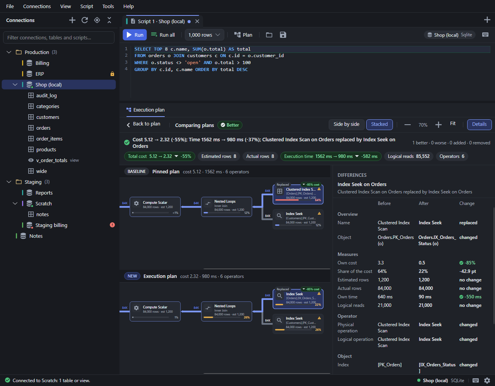

# dbExplorer

A lightweight Windows desktop app to explore and edit databases (PostgreSQL, SQL Server, SQLite) faster than DBeaver:
launch in about a quarter of a second, switch between connections instantly, jump to any table or column by typing its
name, follow foreign keys, filter and edit rows, run SQL scripts. .NET 10 + Avalonia 11, native ADO.NET drivers
(Npgsql, Microsoft.Data.SqlClient, Microsoft.Data.Sqlite), Windows only.

Design notes: [`docs/superpowers/specs/2026-11-20-dbexplorer-design.md`](docs/superpowers/specs/2026-11-20-dbexplorer-design.md).

## Screenshots

Light and dark follow Windows. More screens, and the design tokens: [`docs/ui/README.md`](docs/ui/README.md).

| Table tab (light) | Script tab (dark) |
| --- | --- |
|  |  |


## Features

- **Connection tree**: folders (one level) > connection > schema > table/view (SQLite has no schema level). Several
  connections stay connected at once, one session each. Drag a connection into a folder; add, rename, edit, delete.
  A **Groups** section at the top lists the linked database groups (see below).
- **Import from DBeaver**: folders, connections, credentials and virtual keys (see below).
- **Table tabs**, labelled `connection · table` with a colour chip per connection, each with two sub-tabs:
  - **Data**: pages of 200 rows (OFFSET paging), total row count only on demand (Count button), column sort,
    per-column filter row (`contains` by default, `=`, `!=`, `<`, `>`, `null`, `!null`, `in (a,b)`, combined with AND),
    "filter by this value" from the cell context menu, and a raw `WHERE` box. Filters run server-side with parameters.
  - **Structure**: columns, types, nullability, primary key, foreign keys, indexes.
- **Follow foreign keys**: `Ctrl+click` (or double-click) an FK value to open the referenced row in a new tab.
- **Quick open**: fuzzy-search tables/views of the active connection (`Ctrl+T`) or of all connections (`Ctrl+Shift+P`,
  served from an on-disk metadata cache, never connects by itself); `Ctrl+L` jumps to a column in the current table.
  The search forgives typos (a wrong, extra or missing letter, two letters swapped; from 4 letters on), exact matches
  rank first, and `Ctrl+T` reopens with the text you typed last time, selected (type to replace it, Enter to reuse it).
- **Row editing**: edits are staged in the grid (highlighted), `Ctrl+S` shows the generated SQL, then applies it in one
  transaction. Insert and delete rows. Tables without a primary key are read-only until you define "virtual key"
  columns for them (persisted, like DBeaver's virtual PK). Edit is disabled on connections flagged read-only.
- **Script runner**: a SQL editor tab per connection (AvaloniaEdit, syntax highlighting). `F5` runs the whole script,
  split on `;` (respecting quotes, comments and `$$` bodies) and on `GO` lines for SQL Server. `Ctrl+Enter` with nothing
  selected runs the statement under the cursor, which also ends at a **blank line** (outside strings, comments and `$$`
  bodies; T-SQL needs no `;`), so a SELECT followed by a blank line and an UPDATE never run together; a cursor on a blank
  line runs the statement above it. A selection runs as selected (split by `;`/`GO` only). One result grid per result
  set, rows affected and duration, cancel button, and a "Rows" limit box (default 1000, up to 100 000): a result cut at
  the limit says so, raise the limit and run again. Honours the connection read-only flag. Scripts are plain files;
  unsaved editor contents are restored at the next start: from the saved tab list, plus any autosave copy written after it
  (e.g. after a crash); older copies the list does not mention stay in `scripts\` and the status bar says how many.
- **One connection per script tab**: the tab opens its own connection on its first run and keeps it, so `BEGIN TRAN`,
  temp tables (`#t`), variables and `SET` options survive from one run to the next, and `ROLLBACK`/`COMMIT` in a later run
  works. It is released when the tab closes (a transaction still open is rolled back), on Disconnect, when the connection
  is edited, or when it is found broken; the next run then reconnects and the status bar says the session state was reset.
- **Tabs survive closing the app**: the open tabs come back at the next start, in the same order and with the same tab
  active: tables (with the connection they are on now, so a tab switched to another group member returns on that member,
  plus column filters, WHERE and sort) and scripts (connection, file, and any unsaved text from the autosave). Only the
  active table tab loads at start (it connects and reads its first page in the background, after the window is shown);
  every other restored table tab loads, connecting if needed, the first time you select it, and scripts connect only when
  they run. Nothing connects before the first paint. A tab whose connection was deleted is skipped; one that cannot
  connect shows the usual error with Reload. Tabs you closed yourself are not restored (and neither is a script you chose
  Discard for when closing the window); the Ctrl+Shift+T history of closed tabs is not kept across runs. The list is saved
  about a second after every change and when the window closes, in `session.json`. To start with no tabs, delete that file:
  the app then restores only the unsaved scripts, as before. A script whose autosave copy or file cannot be read is not
  opened as an empty dirty tab: its copy stays on disk, or it opens empty and unlinked from the file, with a message.
- **Linked database groups**: link databases that share one schema (dev, preprod, customer copies) into a named group, switch
  a tab between them with one key press, run the same read-only query on all of them at once and see where the results
  differ, or compare their schemas. Details, shortcuts and limits: [Linked database groups](#linked-database-groups).
- **N2F database upgrade**: play the dbupdate scripts of one sprint of the n2f repo on the current database or on a whole
  group, with a preview, warnings (index creation, long-running statements) and a confirmation. Gear menu: **Options...**
  and **Upgrade database...**. Details: [N2F database upgrade](#n2f-database-upgrade).
- **Safety**: nothing is written without an explicit save; passwords are stored encrypted with Windows DPAPI (current
  user); SQL Server connections expose `encrypt` and `trustServerCertificate`.
- Light/dark theme follows Windows.

## Linked database groups

A **group** is a named, ordered list of connections that have the same schema and the **same engine** (all PostgreSQL, all SQL
Server or all SQLite). It only references connections: credentials and the read-only flag stay on each connection, a
connection can be in several groups, and deleting a connection removes it from its groups. Groups are stored in `config.json`
(an older file without groups loads unchanged).

**In the navigator.** The **Groups** section (it appears once a group exists) lists each group with its engine and member
count; a group expands to its members, which are shortcuts to the real connections (double-click connects one). Create a group
with the **New group** button of the navigator toolbar or from a group's menu; a connection's menu has **Add to group...**
(one of the groups it could join, or a new group started with it). A group's menu: **Check schema differences**, **Edit
group...**, **Rename...**, **Delete group** (the connections are kept) and **New group...**; a member's menu: **Connect** and
**Remove from group**.

**Group editor.** A name plus two lists: the available connections and the members in order (add, remove, move up / down;
double-click moves an entry). The first member fixes the engine, and only connections of that engine are offered afterwards.
Saving is refused for an empty or duplicate name. A group with fewer than two members can be saved (a banner says it needs two
to switch or compare); it just has no selector and no run on group.

**Schema-difference report** (group menu, **Check schema differences**). Connects to every member (4 at a time, with the
status-bar spinner and Cancel), reads their schemas and shows, for each database against the rest of the group: missing and
extra tables / views, missing and extra columns, columns whose data type differs, and an object that is a table in some
databases and a view in others. Indexes, keys and constraints are not compared. A database that cannot be reached is listed
in the report and never stops the others. Informational only; the connections it opened stay open in the navigator.

**Switching a tab between members.** A table or script tab whose connection is in a group with other members shows a database
selector (group icon, previous / next chevrons and a list of the group's databases; a group picker too when the connection is
in several groups). `Ctrl+Alt+PageDown` / `Ctrl+Alt+PageUp` move to the next / previous database of the group, wrapping around.

- A **table tab** reloads the same table on the other database with the same filters, raw `WHERE` and sort, from page 0.
  Pending edits go through the usual Save / Discard / Cancel question first. If the other database cannot be reached or has no
  such table, an error strip says so and the tab stays exactly as it was (edits you chose to discard stay discarded).
- A **script tab** keeps its text and its results; the next run uses the other database. Its own dedicated connection to the
  old database is released at the switch, so a transaction left open there is rolled back (as when the tab closes).
- A switch is refused while a script or a group run is running in that tab.

**Run on group** (script tab on a connection that is in a group; the "Run on group" and "Script on group" buttons only show
then). `Ctrl+Shift+Enter` runs the selection or the statement under the cursor (same rules as `Ctrl+Enter`), `Ctrl+Shift+F5`
the whole script, on every database of the group at the same time (4 at a time, not configurable), with the tab's row limit
applied per database. A status panel lists every database as waiting, running, done (rows and time), failed (with its error)
or cancelled, with a Cancel button on each line and **Cancel all** (`Ctrl+Break` too). One slow, unreachable or failing
database never blocks the others. The results:

- **All**: the rows of every database in one grid with a leading `Database` column, merged on the columns that all databases
  have (a notice names the columns that were left out).
- **Differences only** (check box on the All tab): only the rows that are not identical in every database, with a leading
  `Present in` column naming the databases that have the row (`name×2` when a database has it twice). Rows are compared on all
  their values, NULLs included; numbers, dates and GUIDs are compared by value across engines.
- **One tab per database**: that database's own result grid (or its error) for the compared statement.
- A database that failed, was cancelled or returned no columns is left out of All and Differences and named in a notice. A
  result cut at the row limit says so, and warns that the differences may then be false.

**Read-only guarantee.** A group run is read and compare only. Every statement goes through the engine-aware read-only guard
and every database runs in a read-only context, **whatever the read-only flag of each connection says**: a connection that is
editable on its own is still read-only in a group run. It is exactly as strong as the read-only mode of an ordinary connection
(see Known limitations: a lexical guard that does not know functions with side effects, plus a database-enforced read-only
context on PostgreSQL and SQLite and a rolled-back transaction on SQL Server). A write statement (or anything the guard cannot prove to be a read)
refuses the whole run for all databases with "Group runs are read-only; run writes on one database at a time". This check
runs first, before the app starts resolving any member's session, and the runner repeats it as its own guard before it opens
a connection. Other refusals are reported the same way: an empty script, or a run, a switch or a reconnect already in
progress, are also caught before any session is touched; a group whose databases are of different engines (only possible
with a hand-edited `config.json`) is refused by the runner, after the app has started resolving the members' sessions
(connecting the ones that are not connected in the navigator) but before any group connection is opened or any statement runs.
Writing on several databases of a group at once is possible only through the separate [N2F database upgrade](#n2f-database-upgrade), which has its
own runner and its own confirmation and is never reachable from Run on group.

**Limitations.**

- Groups are same-engine only (enforced when editing a group). Changing the engine of a connection that is in a group is
  refused: remove it from its groups first.
- The fan-out is read-only: no write, DDL or migration on several databases at once, no data sync, no row-level table diff (the separate [N2F database upgrade](#n2f-database-upgrade) is the only write path on several databases, and it is not part of Run on group).
- Each group run opens **one fresh dedicated connection per database** and closes it when that database is done. It never
  uses the script tab's own connection, so a `BEGIN TRAN` or a temp table of an ordinary run is neither seen nor disturbed.
- There is **no automatic timeout** on a statement: a slow query keeps running until it ends or you cancel it (the line's
  Cancel button, or Cancel all). Only connecting gives up on its own (10 s on PostgreSQL and SQL Server).
- For a whole script (`Ctrl+Shift+F5`), All and Differences compare only the **last statement that returned rows**, and the
  per-database tabs show only that same statement (a notice says which of the N statements it is). To compare another
  statement, run it alone with `Ctrl+Shift+Enter`.
- While a group run is active, an ordinary run, a database switch and a second group run are refused in that tab.
- Results are kept in memory: the row limit applies per database (default 1000, up to 100 000).

## Script library


Scripts you keep live in a **library**: plain `.sql` files in `%APPDATA%\dbExplorer\library\`, organised in real
sub-folders (any depth). Nothing is stored twice: a script tab simply points at its file, so saving, autosave and "open in
Explorer" work like for any file. The **Scripts** section of the navigator (View > Show scripts) lists it, folders first,
names in natural order (`q2` before `q10`).

- **Open**: double-click or `Enter` on a script. It opens on the active (or last selected) connection; a script that is
  already open just gets its tab back.
- **Save**: `Ctrl+S` on a script that was never saved asks for a **name and a library folder** (with **New folder...**); a
  name that exists is never overwritten (`name (2).sql`). **Choose another location...** uses the system file dialog, as does
  File > **Save script as...** at any time. A script that already has a file keeps saving silently to it.
- **Organise** (right-click, `F2` rename, `Delete`): rename, duplicate, move to a folder (or drag it onto a folder), delete (asks;
  a folder says how many scripts it holds; files are deleted for good), new script / new folder here, copy path, show in
  Explorer, refresh, open the library folder. Names cannot contain `\ / : * ? " < > |` or `..`; nothing leaves the library
  folder and a move or rename never overwrites. An open tab follows its file when it is renamed or moved.
- **Recent scripts**: File > **Recent scripts** lists the last 20 scripts opened or saved (library or not), most recent
  first, the full path as tooltip; files that are gone are dropped. Kept in `recent-scripts.json`.
- The navigator filter box also matches script names.

## Query history

Every statement you run from a script tab is recorded (when it ran: the failed or read-only-refused one is recorded with its
error, an estimated plan is marked as such). `Ctrl+Shift+H` or View > Query history opens the window:

- a search box that filters live on the SQL and the connection name, and the chips **All**, **Errors** and **This connection**
  (the connection of the active tab);
- the list, newest first: connection colour chip, two-line SQL preview, time ago (exact time in the tooltip), duration, rows, a
  *Failed* badge, an *Estimated / Actual plan* badge;
- the full statement and the error on the right, with **Copy SQL** and **Delete**; **Open in new tab** (`Enter`, double click)
  opens it on its connection (on the active one when that connection was deleted), **Run again** opens it and runs it;
  **Clear all…** asks before deleting everything. `Down` goes from the search box to the list, `Delete` removes the entry, `Esc` closes.

The history is a plain JSON-lines file (`history.jsonl` in the data folder), read only when the window opens, capped at the latest
5,000 statements; a statement longer than 20,000 characters is cut with a marker. A damaged line is skipped, an unwritable file only
means nothing is remembered. Tools > Options switches the recording off and has a "Clear history" button (setting `RecordHistory`).
Group runs (one statement on every database) are not recorded.

## SQL formatting

`Ctrl+Shift+F`, the toolbar button next to Save and **Script > Format SQL** format the selection, or the whole script when
nothing is selected. It is one edit of the editor: `Ctrl+Z` brings the old text back in a single step, and the caret stays on
the token it was on. The formatter is our own (no dependency) and built to be safe:

- it only moves whitespace and, optionally, changes the case of keywords. Strings, quoted identifiers (`"x"`, `` `x` ``, `[x]`),
  comments (a trailing `-- note` stays at the end of its line), `$$ ... $$` bodies, `GO` lines, `;`, variables (`@x`, `:x`,
  `$1`), operators and numbers are never rewritten. Function names and identifiers keep their case (SQLite names an
  unaliased column after its text);
- every statement is re-read after formatting and compared token by token with the original. A difference, or a character the
  lexer cannot classify, leaves that statement as it was; statements it does not lay out (`DECLARE`, `ALTER`, procedures,
  anything unknown) only get their runs of spaces collapsed and keywords cased, line breaks and indentation stay;
- formatting twice gives the same text.

Layout: one clause per line (`SELECT`, `FROM`, `WHERE`, `GROUP BY`, `HAVING`, `ORDER BY`, `LIMIT`, `UNION`...), the select
list one item per line when there are several, `JOIN ... ON` with the condition on an indented line, `AND` / `OR` at the start of
a line, subqueries and CTEs as indented blocks, `CASE WHEN ... THEN ... END` on separate lines, `INSERT ... VALUES`, `UPDATE ... SET`,
`DELETE`, `MERGE` and `CREATE TABLE` (one column per line) laid out the same way, short lists (`IN (1, 2, 3)`, function calls)
kept on one line and long ones wrapped at 100 columns. The rules follow the tab's engine (`TOP` on SQL Server, `RETURNING`
and `::` on PostgreSQL, `GO` lines on SQL Server).

**Tools > Options > SQL formatting** sets the keyword case (upper, lower, as typed), the indent (2, 4, 8 spaces or a tab) and
the comma position (end or start of the line), with a live preview. They are saved in `config.json` (`Format`).

## Execution statistics

SQL Server script tabs have a **Statistics** check box in the toolbar (hidden for PostgreSQL and SQLite). With it on, the
next runs send `SET STATISTICS IO ON; SET STATISTICS TIME ON` on the tab's connection before your statements and
`... OFF` after them (a session setting sent as commands, not added to your text: the read-only guard, the statement
split and an open transaction are unaffected, and no option is left on the reused connection). The server messages are
captured per statement (`InfoMessage`; errors still fail the statement exactly as before) and two tabs appear after the
statement tabs, replaced by each run: **Statistics** and **Messages**. With the box off nothing is captured and nothing
changes. The box is per tab and not remembered across restarts.

**Statistics** is one grid, sortable by a click on a header (numbers by value, NULL last):

| Column | Content |
| --- | --- |
| `Database` | only in a group run: the member the row comes from |
| `Statement` | 1-based position of the statement in the run |
| `Kind` | `IO` (one table), `Parse/compile` or `Execution` (STATISTICS TIME), `Total` (sums of the statement), `Grand total` (sums of the run, or of the database in a group run; only when more than one statement has statistics) |
| `Table` | the table of an `IO` row (`Worktable`, `#temp` tables included) |
| `Scan count`, `Logical reads`, `Physical reads`, `Read-ahead reads`, `LOB logical reads`, `LOB physical reads`, `LOB read-ahead reads` | the IO counters (four page-server columns follow only when one of them is not 0, i.e. on Azure Hyperscale) |
| `CPU ms`, `Elapsed ms` | the TIME values (empty on `IO` rows) |

A stored procedure reports each inner statement and then the call itself, so its `Total` time can exceed the wall-clock
time. **Messages** lists every line the server sent (`PRINT`, warnings, the statistics lines), one per row, with the
statement number and the time; "Copy value" in the cell menu copies a whole line.

The server writes these lines in the language of the login (English, French, ...). They are read **by structure**, not by
keyword: a table name between quotes followed by 7 (older servers) or 11 counters, and two `= N ms` values for the times
(only the parse/compile versus execution split looks at words: English and French, else execution). A line that does
not match stays a plain message; nothing is ever dropped or raised.

**Run on group** honours the check box: every database sets the options on its own read-only connection and the extra
**Statistics** tab has a leading `Database` column, so the IO of the databases can be compared side by side. A write
statement is still refused before any database is contacted.

Limits: SQL Server only. A result cut at the row limit cancels its command, so the lines the server would have sent at the
end of that statement are lost; a cancelled statement yields none. `SET STATISTICS ...` typed in the script itself keeps
working as before but is only captured when the check box is on. The `DBX_MSSQL` integration tests check the capture and
the French messages against a real server ([Integration tests](#integration-tests-against-real-databases)).

## Execution plans


The script toolbar has a **Plan** button (`Ctrl+L`) and an **Actual plan** switch (`Ctrl+M`), like SSMS:

- **Estimated plan** (`Ctrl+L`): the plan the optimizer would use for the selection or the statement at the caret. Nothing is run,
  so it is allowed on a read-only connection, even for a write statement. SQL Server: `SET SHOWPLAN_XML`. PostgreSQL:
  `EXPLAIN (FORMAT JSON)`. SQLite: `EXPLAIN QUERY PLAN` (no cost or row counts: a tree of scans and searches).
- **Actual plan** (switch on, then run as usual): the statements run, the rows stay in their tabs, and an **Execution plan**
  tab is added with the real row counts and times. SQL Server: `SET STATISTICS XML` (the rows past the row limit are read
  and dropped so that the plan, which the server sends last, is received). PostgreSQL: `EXPLAIN (ANALYZE, BUFFERS)`, which
  runs the statement but does not return its rows. SQLite has no actual plan.

The plan tab, one chip per statement when a run has several (with its share of the batch):

- **Canvas**: the root on the left, data flowing right to left, one card per operator (icon of its family, object, rows
  actual / estimated, a cost bar and its share of the statement). Arrows are as thick as the rows they carry and show the
  count; the path from the selected operator to the root is lit. Colour the bars by **Cost**, **Time** or **Rows**.
  Click to select, arrow keys walk the tree, `Ctrl+wheel` or `Ctrl +` / `Ctrl -` zoom, `Ctrl+0` or **Fit** shows it all,
  drag the background to pan. It opens on the costliest operator.
- **Properties**: everything the server says about the selected operator (costs, rows, times, I/O, object, predicates, seek
  predicates, output columns, buffers...) plus the statement's own (parallelism, memory grant, parameters, timings).
- **Top operators**: the costliest first; a click finds it in the plan.
- **Issues**: the warnings (spills to tempdb or disk, no join predicate, missing statistics, implicit conversions), the
  operators whose row estimate is 10 times off (where the error starts, not every operator above it), scans that an index
  could turn into seeks, key lookups, and SQL Server's **missing index** hints with a ready `CREATE INDEX` (**Copy**).
- **Copy plan** and **Save plan...**: the plan as the server sent it. A SQL Server `.sqlplan` opens in SSMS.

**Comparing two plans** (before and after an index or a rewrite):



- **Pin plan** keeps the plan on screen as the baseline of the script tab. A run clears the result tabs, but the pinned plan
  stays: after the next run, **Compare with...** offers "Pinned plan" first. The menu also lists the other statements of the
  tab. Without a pinned plan it says how to get one.
- The comparison replaces the plan view (**Back to plan** returns): the baseline above (or on the left, **Side by side**) and
  the new plan below, with the same cards. Operators are matched by structure (same operator on the same table first, an
  index change counts as the same operator replaced), so every matched card carries a badge (`-85% cost`, `-550 ms`), an
  operator that only exists on one side gets a dashed outline and an **Added** / **Removed** tag, and a scan turned into a
  seek is tagged **Replaced**.
- The header says it in words ("Cost 5.12 -> 2.32 (-55%); Clustered Index Scan on Orders replaced by Index Seek on Orders") and
  shows the figures as chips: total cost, rows, execution and planning time, logical reads, operator count. Green with a
  check or a down arrow is better, red with a warning or an up arrow is worse, a change of 10% or less is "no change"; row
  counts are neutral. Colour is never the only signal: every chip and badge has an icon and a figure.
- Click an operator on one side and its counterpart is selected on the other; **Differences** lists the name, object, cost,
  share, rows, time, reads and every property that changed (before, after, change). Metrics a plan does not report are
  skipped, so plans of different engines compare as far as they have figures in common.

Plans are per run and not run on a group. The `Time` colouring needs an actual plan. The SQL Server parser reads the
standard showplan XML by local names (any schema version) and skips what it does not know.

## Search in scripts and data

`Ctrl+Alt+F` (or View > Search in scripts and data…) opens one search overlay with two scopes. Enter searches, the arrow keys
select a result, Enter opens it, Esc closes (the last results are shown again the next time).

- **Scripts**: full-text search in the open script tabs (their current, possibly unsaved text, marked *unsaved*) and in every
  `.sql` file of the script library. Options: match case (`Aa`), whole word (`ab`), regular expression (`.*`; an invalid pattern
  is explained under the box, and a pattern that backtracks for more than a second on a line gives up on that line). Files over
  5 MB, binary and unreadable files are skipped and counted in the status line. Results stream in, grouped by script, at most
  2,000 matches (then a "more results are not shown" notice). A result opens the script at that line with the match selected.
- **Data**: finds a value in the data of a connection (connected on demand): match mode *Contains* / *Is exactly* / *Starts with*,
  an optional schema and an optional table-name filter. Each table is read once with a bounded, read-only, parameterised query
  (text columns, and number, GUID and date columns the text can match, compared as text; binary columns are never read; views
  are skipped), up to 4 tables at a time, 20 rows per table, a table that takes more than 2 minutes is abandoned and listed.
  The status line shows the progress ("table 12 of 140") and Stop ends the search keeping what was found. A result shows the row
  (key and leading columns, the matching cell in bold); it opens the table filtered on that column and value. Searching a large
  database can take a while: the overlay says so.

## Keyboard shortcuts

| Shortcut | Where | Action |
| --- | --- | --- |
| `Ctrl+Alt+F` | anywhere | Search in scripts (open tabs and library) and in the data of a connection |
| `Ctrl+T` | anywhere | Quick open a table/view of the active connection |
| `Ctrl+Shift+P` | anywhere | Quick open a table/view across all connections (metadata cache) |
| `Ctrl+Shift+T` | anywhere | Reopen the last closed tab (like a browser; press again to go further back; up to 50 are remembered; a table keeps its filters, a script its text) |
| `Ctrl+Shift+H` | anywhere | Query history: search, filter, re-open or re-run the statements you ran (View > Query history) |
| `Ctrl+L` | table tab | Fuzzy-search a column and scroll to it |
| `Ctrl+L` | script tab | Show the estimated execution plan of the selection / the statement under the cursor (nothing runs) |
| `Ctrl+M` | script tab | Include the actual execution plan in the next runs (switch) |
| `Ctrl+N` | anywhere | New script tab on the active (or selected) connection |
| `Ctrl+O` | anywhere | Open a script file in a script tab |
| `Enter` / `F2` / `Delete` | navigator, a script or script folder | Open / rename / delete it (see [Script library](#script-library)) |
| `Ctrl+Enter` | script tab | Run the statement under the cursor (ends at `;`, a `GO` line or a blank line) or the selection |
| `F5` | script tab | Run the whole script; in a table tab: reload the data |
| `Ctrl+Shift+F` | script tab | Format the selection, or the whole script when nothing is selected (see [SQL formatting](#sql-formatting)) |
| `Ctrl+Shift+Enter` | script tab on a connection in a group | Run the statement under the cursor / the selection on **every database of the group** (read-only, see [Linked database groups](#linked-database-groups)); in a script tab that is not in a group the status bar only says so (no ordinary run) |
| `Ctrl+Shift+F5` | script tab on a connection in a group | Run the whole script on every database of the group (read-only) |
| `Ctrl+S` | script tab / table tab | Save the script (the first time: name and library folder) / review the SQL and apply staged edits |
| `Ctrl+W` | anywhere | Close the active tab |
| `Ctrl+Tab` | anywhere | Next tab |
| `Ctrl+Shift+Tab` | anywhere | Previous tab |
| `Ctrl+Alt+PageDown` | table / script tab on a connection in a group | Switch the tab to the next database of the group (wraps around) |
| `Ctrl+Alt+PageUp` | table / script tab on a connection in a group | Switch the tab to the previous database of the group (wraps around; with several groups, the group picked in the selector) |
| `Esc` | quick open overlay | Close the overlay |
| `Esc` | table tab | Discard staged edits: specified in the design, **not wired yet** (use the Revert button; in a cell editor Esc cancels that edit) |
| `Ctrl+0` | table grid, cell selected | Set the cell to NULL (staged) |
| `Ctrl+Break` | script tab | Cancel the running query, or the running group run (all databases) |
| `F2` | table grid | Edit the cell |

## Installation

Requirements: Windows 10/11 and the GitHub CLI (`winget install --id GitHub.cli`; `gh auth login` if the repository is
private). No admin rights and no .NET needed (the release is self-contained). `install.ps1` runs in Windows PowerShell 5.1
and PowerShell 7; it downloads the latest release with `gh`, verifies its SHA-256, and installs it for the current user.

One-liner, straight from GitHub (add the parameters after the closing parentheses, for example `-Version 1.0.4 -DesktopShortcut -Launch`):

```powershell
& ([scriptblock]::Create((gh api repos/JonathanOll/dbExplorer/contents/install.ps1 -H 'Accept: application/vnd.github.raw' | Out-String)))
```

Or download, then run (`-ExecutionPolicy Bypass` because many machines block local scripts; `Out-File -Encoding ascii` because
`>` writes UTF-16 in Windows PowerShell 5.1):

```powershell
gh api repos/JonathanOll/dbExplorer/contents/install.ps1 -H "Accept: application/vnd.github.raw" | Out-File -Encoding ascii install.ps1
powershell -NoProfile -ExecutionPolicy Bypass -File .\install.ps1 -Version 1.0.4 -DesktopShortcut
```

Piping the script into `powershell -Command -` does not work (a script with a `param` block is not accepted on stdin).
`... | Out-String | iex` runs, but in your current session, without parameters, and leaves strict mode on in it: prefer the
script block form above.

| Parameter | Effect |
| --- | --- |
| `-InstallDir <path>` | Where to install (default `%LOCALAPPDATA%\Programs\dbExplorer`) |
| `-Version <tag>` | `1.0.4` or `v1.0.4` (default: the latest release) |
| `-Repository <owner/name>` | Default `JonathanOll/dbExplorer` |
| `-DesktopShortcut` / `-NoStartMenu` | Add a desktop shortcut / skip the Start Menu shortcut (created by default) |
| `-Launch` | Start the app at the end |
| `-Force` | Reinstall the same (or a newer) version; close a running dbExplorer without asking (window first, killed after 20 s) |
| `-Uninstall` | Remove the app (see below) |
| `-RemoveUserData` | With `-Uninstall`: also delete `%APPDATA%\dbExplorer`, after a confirmation unless `-Force` |
| `-Quiet` | Only warnings and errors |
| `-WhatIf` / `-Confirm` | Standard PowerShell switches |

Run again to update: the same version is left alone (`already installed`), an older one is upgraded. A running dbExplorer
makes the installer stop (close it, or pass `-Force`). Errors print a cause and a fix, and exit with a non-zero code.

What it creates:

- the app in `%LOCALAPPDATA%\Programs\dbExplorer` (a writable folder, as the in-app updater needs); the installer replaces
  everything in it and refuses a non-empty folder that is not a dbExplorer install;
- a copy of the script in `%LOCALAPPDATA%\Programs\dbExplorer-setup\install.ps1`: it is the uninstaller, kept outside the install
  folder because the in-app updater empties that folder;
- the Start Menu shortcut `dbExplorer.lnk` (and the desktop one on request);
- an "Apps & features" entry (`HKCU\Software\Microsoft\Windows\CurrentVersion\Uninstall\dbExplorer`, per user).

Uninstall: Settings > Apps > dbExplorer, or

```powershell
powershell -NoProfile -ExecutionPolicy Bypass -File "$env:LOCALAPPDATA\Programs\dbExplorer-setup\install.ps1" -Uninstall
```

It removes the files, the shortcuts, the entry and the setup copy (deleted a few seconds after it exits). `%APPDATA%\dbExplorer`
(config, sessions, scripts) is kept unless `-RemoveUserData` is given, and is never touched by an install or an update.

The installer and the [automatic updates](#automatic-updates) work on the same folder: after an in-app update, running
`install.ps1` sees the new version (it reads it from the exe) and does nothing. Only the version shown in "Apps & features" keeps
the one that was installed by the script.

Test: `pwsh .\scripts\test-install.ps1 [-Engine pwsh]` runs the real script against throw-away folders and a throw-away registry
key (needs network and `gh`; it downloads the latest release a few times) and checks that nothing else was touched.

## Build, test, publish

Requirements: Windows 10/11, the .NET 10 SDK, and PowerShell 7 (`pwsh`) to run `publish.ps1` and `scripts\measure-startup.ps1`
(they will not run in Windows PowerShell 5.1).

```powershell
dotnet build DbExplorer.sln -c Release
dotnet test  DbExplorer.sln                 # 980+ tests; DB integration tests are skipped unless configured, see below
dotnet run --project src/DbExplorer.App -c Release
```

Fastest-launching build, into `dist\`:

```powershell
.\publish.ps1                      # self-contained, ReadyToRun composite, ~160 MB, launches in ~0.26 s
.\publish.ps1 -FrameworkDependent  # ~57 MB, needs the .NET 10 runtime, launches in ~0.32 s
```

`publish.ps1` cleans `dist\` and the `obj\` folders, publishes `win-x64`, prints the exe path and size, then launches the
published exe 5 times against a throw-away data dir and prints the startup numbers (use `-Runs N` for more).
Do not enable trimming: Avalonia bindings and the database providers use reflection.

## N2F database upgrade

Plays the SQL scripts of one sprint of the n2f `dbupdate` folder (`Web/Common/n2jWeb.Data/dbupdate`) on the current database
or on every database of one of its groups, after a preview with warnings and an explicit confirmation. It is a **separate,
explicit write path**: [Run on group](#linked-database-groups) is unchanged and stays read-only. SQL Server only.

**Setting.** Gear menu of the navigator toolbar, **Options...**: the path of the dbupdate folder (Browse or type it; a valid
folder shows how many version folders it holds). Stored in `config.json` as `DbUpdatePath`; empty (the default, and what an
older file means) switches the feature off. The folder is validated when OK is pressed, after Browse and when the box loses
focus, and the gear menu's **Upgrade database...** is only enabled when the saved path still validates (checked each time the
menu opens). The path must exist and contain at least one `v...` folder. Nothing is read at launch and nothing is scanned
until you open **Upgrade database...** (that scan is a directory listing; scripts are read when you press Load).

**Folder layout understood.** Only the top-level `v<NNNN>...` folders are looked at (`v0860-sprint 143`, `V0121-change x`,
`v0010-hotfix-...`); the other folders and files at the root (`_functions`, `_views`, legacy scripts...) are out of scope.
The sprint number is read from `sprint 143` / `sprint-143` in the folder name, and one sprint can span several folders
(`v0860`, `v0861`, `v0862`): they are played together. A folder without a sprint number (a hotfix) is not reachable by
sprint number; pick it by folder in the dialog. In a version folder only the top-level `*.sql` files are read; anything else
(sub-folders, `.txt`, `.sql.bak`) is not played and is listed in the preview as ignored. Order: folder version number
ascending, then folder name, then file name in natural order (`adj - 003` before `adj - 037`). A script whose name ends with
`- Production1`, `- Production2`... targets specific servers: it carries that label and starts **unticked**.

**Upgrade database... dialog** (needs a connection selected in the tree or an open tab: that is the current database).

1. **Sprint**: type the number and press Load (Enter works), or pick a version folder in the **or folder** list (newest
   first); the two exclude each other. An unknown sprint says so and names the nearest ones. **Run on** lists the current
   database and, when it belongs to groups of two or more databases, each of those groups.
2. **Preview**: one line per script (folder, file name, Production label, one badge per warning with its reason and line in
   the tooltip), a check box on each (a script that cannot be played cannot be ticked), a summary of the warnings of the
   ticked scripts (`3 warnings: 2 index, 1 long-running`) and the list of ignored files. Press **Run...**.
3. **Confirmation**: the number of scripts, the databases, every warning of the ticked scripts, and a note when Production
   scripts are ticked. For a group you must type the sprint number (the folder code, such as `v0860`, for a run by folder)
   before **Run** is enabled; **Back** returns to the preview with the ticks kept.
4. **Run**: the databases run 4 at a time (not configurable). Each has a line: waiting, `running: script 3 of 12 - name`,
   `done - 12 scripts - 4.2 s`, `failed at <script>: batch k of n: <error>` or cancelled, with a Cancel button on each line
   and **Cancel all**. The window cannot be closed while a run is in progress. When it ends, **Copy log** puts a text log
   (every database, one `OK` / `FAILED` / `CANCELLED` / `SKIPPED` line per script, the errors) on the clipboard. The sprint is not
   remembered.

**What blocks a run.** The check happens at Run..., again before any connection is opened, and the runner repeats it, so a
refusal contacts no database and nothing is run:

- A **read-only connection** among the targets: it is named in the message (untick Read-only in its menu first). The flag is
  read again from the live configuration when each database is opened.
- A target that is not **SQL Server** (the scripts are T-SQL), or databases of mixed engines.
- A script that cannot be played as written, shown on its line in the preview: it cannot be read; it has a **`GO n`**
  repeat count (anything but `GO` or `GO 1`) or another line that starts with `GO` and is not a separator (`GO;`,
  `GO SELECT 1`); or it contains a **`USE <db>`** statement, which would move the rest of the script to a database nobody
  confirmed (also checked inside `EXEC('...')` and `sp_executesql`). While one such script is listed, nothing can be run, even
  if you untick it. Fix the script, press Load again.
- No script ticked.

A database that is in the target list twice is upgraded once, and the log says so.

**Warnings.** Each script is scanned for statements that are likely to be slow or to take locks. A warning is information
only and never blocks. It is a heuristic over the SQL tokens (comments, strings and `[bracketed]` names are ignored; the
string literals of `EXEC('...')` and `sp_executesql N'...'` are scanned with the same rules; SQL assembled from variables
is not seen):

| Badge | Raised by |
| --- | --- |
| Index | `CREATE [UNIQUE] [CLUSTERED \| NONCLUSTERED \| COLUMNSTORE ...] INDEX`; `ALTER INDEX ... REBUILD`; `ALTER TABLE ... ADD PRIMARY KEY` or `UNIQUE` (the constraint builds an index); `CREATE`, `ALTER` or `DROP FULLTEXT INDEX` |
| Long-running | `UPDATE` or `DELETE` with no `WHERE` and no `TOP` (not when it reads the trigger tables `inserted` / `deleted`, has a `TOP` in a derived table of its `FROM`, joins a `#temp` table or `@table` variable, or sits in a `CREATE TRIGGER` body, which runs later and not during the upgrade); `WHILE`; `WAITFOR`; `ALTER TABLE ... ALTER COLUMN`; `INSERT ... SELECT` and `SELECT ... INTO` whose `SELECT` has no `WHERE` and no `TOP` (not into a `#temp` table or an `@table` variable); a script of **100 000 characters or more** (reported as a large script, with its size, on line 1) |

Row counts are not looked at: a `CREATE INDEX` on a small table warns like one on a huge table. A script without any warning
can still be slow.

**What a run does.** For each database, the ticked scripts one after another in the order above, each split into batches on
`GO` lines only (a `;` never splits a batch, so `IF ... BEGIN ... CREATE INDEX ...; END` stays whole); the script text is sent
as it is. A fresh connection is used for every database and closed at the end; the script tab connections are not touched.

- **No transaction wrapper.** Whatever a script commits stays committed, even if a later script fails.
- **No command timeout**: an index build runs until it ends or you cancel.
- **The first error stops that database**: the failing script is reported (batch k of n, the server message), the remaining
  scripts of that database are marked skipped, and the other databases carry on. An unreachable database is a failure of
  that database only.
- **Cancel** (one database or all) interrupts the running statement. Cancelling in the middle of a DDL statement can leave
  that database **partly upgraded**: the server rolls back the statement, not the scripts before it. If a provider does not
  stop at once, the window gives up after a few seconds and says that some databases may be partly upgraded.
- **Nothing is remembered about what was played.** The scripts are replayable by convention (guarded with `IF NOT EXISTS`
  and the like), so playing a sprint again on a database is how you finish an interrupted run. There is no tracking table
  and no version detection; the dialog never asks which version a database is at.
- The rows a script's `SELECT` returns are discarded. Files are decoded from their byte-order mark, else as UTF-8, else as
  Windows-1252.
- The schema shown in the navigator is not refreshed by the run: use the tree's Refresh to see new tables.

**Limits.** SQL Server only; the heuristics above are the only help for spotting a long script; the folder is read as it is on
disk when you press Load (scripts changed afterwards are not re-read); the app cannot tell which scripts a database already
has, only that they are meant to be replayable.

## Configuration and data

Everything lives in `%APPDATA%\dbExplorer`:

| Path | Content |
| --- | --- |
| `config.json` | folders, connections (passwords DPAPI-encrypted for the current Windows user), virtual keys, linked groups, the automatic-update setting, the N2F dbupdate folder (`DbUpdatePath`, empty = upgrade off), the SQL formatting style (`Format`) |
| `cache\` | per-connection metadata cache (schema/table/column names) used by `Ctrl+Shift+P` |
| `scripts\` | unsaved script tabs, restored at the next start |
| `library\` | the script library: your saved `.sql` scripts and their folders ([Script library](#script-library)) |
| `recent-scripts.json` | the last 20 scripts opened or saved |
| `history.jsonl` | the query history, one JSON line per statement, latest 5,000 ([Query history](#query-history)) |
| `window.json` | size, position and maximised state of the main window |
| `session.json` | the open tabs (order, active tab, table filters / WHERE / sort, script files); delete it to forget them (only unsaved scripts then come back) |

A corrupt `config.json` is moved to `config.json.bad-<timestamp>` and the app starts empty with a notice. If the file
cannot be read at all (locked, unreadable) the app starts in read-only-config mode: a red banner says so and nothing is
ever written to it (`session.json` is then neither read nor written either). A corrupt `session.json` is moved to
`session.json.bad-<timestamp>` the same way, with a notice, and the app starts with no tabs from it (the unsaved scripts
still come back). A `session.json` that exists but cannot be read (locked) is not restored and not written for that run, so
it cannot be overwritten; the same holds in read-only-config mode.

### Command line and environment

| Option | Environment variable | Meaning |
| --- | --- | --- |
| `--data-dir <path>` | `DBEXPLORER_DATA_DIR` | Use this folder instead of `%APPDATA%\dbExplorer` |
| `--dbeaver-dir <path>` | `DBEXPLORER_DBEAVER_DIR` | DBeaver config folder for the import. When only the data dir is overridden it defaults to `<data dir>\dbeaver`, never the real workspace |
| | `DBEXPLORER_RENDERING=gpu` | Use Avalonia's default GPU/ANGLE rendering instead of software rendering (see Startup performance) |
| `--no-update-check` | `DBEXPLORER_NO_UPDATE_CHECK=1` | Do not look for a newer release in the background for this run (see Automatic updates) |

A flag without a value is reported in a message box and the app exits (exit code 2). The flags win over the environment
variables.

## Importing from DBeaver

Click **Import** in the navigator toolbar. It reads `%APPDATA%\DBeaverData\workspace6\General\.dbeaver\data-sources.json`
and `credentials-config.json` (or the `--dbeaver-dir` folder): folders, connections, credentials (re-stored DPAPI-encrypted)
and virtual keys. It is a one-time, re-runnable action: connections whose name already exists are skipped, and the live
config is replaced only when the whole import succeeded. Warnings (unsupported drivers, missing credentials) are listed
in the status bar. Only user/password authentication is imported.

Connections that DBeaver marks `read-only`, or whose connection type is `prod` / `production` (or a custom type with
"prod" in its name or one that forbids data edits), are imported **read-only**, on purpose: an imported production database
never silently becomes editable. The status bar names them after the import; untick **Read-only** in the connection's
context menu to edit one. Virtual keys that use "all columns" skip the columns SQL Server / PostgreSQL cannot compare
with `=` (text, ntext, image, xml, json...).

## Automatic updates

A published copy checks GitHub for a newer release a few seconds after the window opened, on a background thread (the
startup path is untouched, see Startup performance). When one exists, a band appears above the window: **Update and
restart** or **Later** (hides it until the next start).

How it works:

1. The release workflow stamps the version (from the tag, via GitVersion) and the `owner/name` of the repository into the
   exe, and attaches `DbExplorer.zip` (a plain self-contained `win-x64` publish) to the GitHub release.
2. The check runs `gh release view` on that repository; a version higher than the running one offers the update. A failed
   check (no `gh`, offline, not logged in, rate limit) is silent: no dialog, at most a trace line.
3. **Update and restart** runs `gh release download` into a fresh temp folder (the band shows the progress) and verifies the
   SHA-256 against the digest GitHub gives for the asset; a mismatch deletes the file and installs nothing.
4. Unsaved work is handled as when you close the window: a table tab with staged edits asks Save / Discard / Cancel (Cancel
   keeps the app open and the download for the next click); unsaved scripts are kept by their autosave and come back, with the
   tabs, at the next start.
5. A hidden Windows PowerShell relay waits for the app to exit, moves the current files to `.update-backup` inside the install
   folder, copies the new ones and starts the new exe with the same arguments. On any failure it puts the backup back and
   starts the old version again; the backup, the zip and the relay are deleted after a success.

Requirements: the GitHub CLI (`gh`) installed and logged in with access to the repository, and the app running from its
install folder (the folder must be writable; [`install.ps1`](#installation) creates one). Nothing is offered for development runs (`dotnet run`, `bin\Debug`,
`bin\Release`), for a build without a stamped version (v1.0.0 is the SDK default and counts as "unknown", so builds from
before this feature and local builds never self-update), or when `DbExplorer.exe` is not what is running.
`%APPDATA%\dbExplorer` (config, sessions, scripts, cache) is outside the install folder and is never touched.

To turn it off: untick **Check for updates automatically** in the navigator's settings (gear) button (saved in `config.json`
as `AutoUpdateCheck`; a config without it means on), or start with `--no-update-check` / `DBEXPLORER_NO_UPDATE_CHECK=1`
for one run. The check is also skipped when the config could not be read at startup.

Limits: the release zip is a plain self-contained `win-x64` publish made by CI (not by `publish.ps1`, and unsigned); only the
latest release GitHub reports is considered; the only integrity check is the SHA-256 GitHub gives for the asset; there is no
"check now" action. A build stamped `1.0.0` (the SDK default) is treated as "unknown": it never self-updates, and a `v1.0.0`
release can only be updated to, not from.

## Integration tests against real databases

The unit tests use fakes and SQLite. The Postgres and SQL Server driver tests also have integration variants that are
skipped unless an environment variable holds a connection string to a scratch database. They create uniquely named
throw-away schemas and drop them afterwards, but do not point them at a database you care about.

```powershell
$env:DBX_PG    = 'Host=localhost;Port=5432;Database=scratch;Username=postgres;Password=...'   # Npgsql connection string, PostgreSQL 11+
$env:DBX_MSSQL = 'Server=localhost;Database=scratch;User Id=sa;Password=...;TrustServerCertificate=True'   # ADO.NET connection string
dotnet test tests/DbExplorer.Core.Tests
```

## Startup performance

The pass/fail bar from the design is a usable window in under about 1 s. Measured on the dev machine (Windows 11,
Release, win-x64) with `scripts\measure-startup.ps1`: it launches the exe with a throw-away `--data-dir` holding a
synthetic 8-connection config, polls the process's own top-level windows until one is visible (no input is ever sent),
reads the working set 3 s later, kills the process. Times are process start to main window visible. A trace inside the
app showed the first painted frame lands about 55 ms after that moment. Median of 10 warm launches.

| Build | Warm median (min-max) | First launch of a fresh build ("cold") | Working set |
| --- | --- | --- | --- |
| Baseline: framework-dependent, JIT (the build before this work) | 716 ms (704-833) | 4 037 ms (2 315 for a fresh publish of the same code) | 89 MB |
| + ReadyToRun (app and all dependencies) | 430 ms (415-443) | 1 343 ms | 82 MB |
| + config load on a worker thread | ~385 ms | ~1 350 ms | 77-82 MB |
| + ReadyToRun composite, framework-dependent | ~325 ms (316-336) | 4 085-4 204 ms | 82 MB |
| **+ ReadyToRun composite, self-contained (published default)** | **260 ms (256-290)** | **3 747-8 730 ms** | **84 MB** |

Restoring open tabs costs nothing before the window is visible: the session file is read on the same worker thread as the
config, and the tabs are rebuilt after the window opened (as shells; only the active table tab connects and queries, in
the background). A/B on a plain Release build (`measure-startup.ps1 -SessionTabs 6`: six table tabs on unreachable servers
plus a script, 12 launches per series, two rounds, the machine was noisy): warm min 766 / 874 ms before, 754 / 863 ms with
the change and no session file, 766 / 768 ms with a six-tab session; medians moved by the machine's noise (785-1099 ms in
every series), not by the feature.

The warm column is the one that matters day to day. The "cold" column is the very first launch after a build or publish
(a new copy of the files); it is dominated by Windows Defender's one-time scan of the new files, not by our code, and
**the composite images make it worse** (about 4-9 s instead of 1.3 s with plain ReadyToRun: the composite image is one
large new file, 24 MB framework-dependent, ~100 MB self-contained). It happens once per publish, and `publish.ps1`'s own
measurement launch absorbs it, so the first launch you do yourself is already a warm one. A true cold start after a
reboot (file cache empty, Defender already done) could not be measured without administrator tools (RAMMap), so the
"under 1 s from a cold disk" bar is verified for warm launches only. If a slow first launch after each publish matters
more than 60 ms per launch, publish with plain ReadyToRun instead (remove `PublishReadyToRunComposite`).
What was tried, and what was kept:

- **ReadyToRun: kept.** The biggest win (716 to 430 ms): the app's own code is no longer JIT-ed (0 of the ~2600 JIT-ed
  methods were ours; they are Avalonia generics and P/Invoke stubs).
- **ReadyToRun composite: kept.** Putting app, Avalonia and the dependencies in one image lets the compiler precompile
  Avalonia's generic instantiations over its own types: JIT-ed methods 2609 to ~1200, about 385 to ~330 ms (A/B on the same
  build, measured before the worker-thread config load).
- **Self-contained (with the runtime in the composite): kept as the publish default.** A further ~65 ms (325 to 260 ms)
  for 160 MB of disk instead of 57 MB; `-FrameworkDependent` is the small alternative.
- **Config load on a worker thread: kept.** Overlaps the ~45 ms config read with Avalonia's ~90 ms platform setup
  (428 to 385 ms). Warming Avalonia control types on a worker thread was tried and rejected: their static constructors
  need platform services of the UI thread (`TypeInitializationException`, process crash).
- **Tiered compilation settings: no effect, left as is.** `TieredPGO=false` and `TieredCompilationQuickJitForLoops=true`
  (already in the csproj) are neutral at startup (PGO on: 430 ms, off: 430 ms); `TieredCompilation=0` is slower
  (589 ms), `TC_QuickJitForLoops=0` is slower (493 ms), `gcConcurrent=0` and a 64 MB gen0 budget do not help.
- **Rendering: software kept as the default.** GPU/ANGLE (`DBEXPLORER_RENDERING=gpu`) starts ~100 ms later (367 ms vs
  260 ms) and uses about 80 MB more RAM (164 MB vs 84 MB). Scrolling a 200 row x 20 column grid by script (360 frames,
  rows and columns) was the same in both: mean frame 17.0 ms software vs 17.7 ms GPU, p95 ~30 ms in both, so the frame
  time is UI-thread layout, not painting.
- **Avalonia/runtime options: rejected, no measurable gain.** `UseWin32().UseSkia()` instead of `UsePlatformDetect()`,
  an explicit default font, `RedirectionSurface` composition only, `InvariantGlobalization`, `UseNls`. There is no custom
  font or `WithInterFont` (the system font is used).
- **Provider assemblies:** Npgsql and Microsoft.Data.SqlClient are not loaded at startup (checked from the loaded-assembly
  list); they load on the first connection of that kind.
- **Linked groups, reopen-closed-tab and fuzzy search: nothing runs before the first paint.** Groups are a few lines of the
  small `config.json` read on the worker thread; the Groups section of the tree is built in memory from it (no I/O, no
  database), and the run, switch, schema-check, reopen and quick-open code only runs on a command. A/B of the published exe
  against the build before this work, interleaved on the same (noisier than above) machine: 316 / 318 ms vs 303 / 323 ms.
- **Trimming / single-file: not used** (Avalonia bindings and the providers use reflection, and it did not look necessary).

## Known limitations

- Large object columns (text, binary) are fully materialised for each 200-row page.
- Linked groups: same-engine only, read-only fan-out, no automatic statement timeout, whole-script runs compare only the last
  row-returning statement (details in [Linked database groups](#linked-database-groups)).
- A lexical guard that does not know functions with side effects: the read-only guard (ordinary read-only connections, the raw
  WHERE box and group runs) looks at tokens, not at what a function does. It refuses a fixed deny-list, matched by exact name
  when followed by `(` (schema-qualified, double-quoted and comment-separated forms included): PostgreSQL server control
  (`pg_terminate_backend`, `pg_cancel_backend`, `pg_reload_conf`, `pg_switch_wal`, ...), statistics resets (`pg_stat_reset*`),
  session-level advisory locks (`pg_advisory_lock*`, `pg_try_advisory_lock*`), `dblink*`, server-side files (`lo_export`,
  `pg_file_*`), replication slot functions, and on SQL Server `OPENQUERY` / `OPENROWSET` / `OPENDATASOURCE` and `NEXT VALUE FOR`.
  Any other function with side effects (a user-defined function that writes, `nextval` / `setval`, ...) is not detected; on
  PostgreSQL and SQLite the database's own read-only context still refuses most of them, on SQL Server nothing but the
  rolled-back transaction does. Obfuscated forms (dynamic SQL built inside a function, aliases, a function reached through a
  view) are an accepted gap.
- No background schema refresh: the schema and the metadata cache behind `Ctrl+Shift+P` are reloaded when a connection is
  (re)opened or on the tree's Refresh action, never while a connection just stays open.
- SQL Server read-only mode is a statement guard plus a rolled-back transaction, not a database-enforced read-only session.
  PostgreSQL uses a `READ ONLY` transaction. SQLite read-only is enforced by the database: the file is opened read-only
  (SQLite is not pooled, so toggling the flag applies to the next connection opened, and a script tab reconnects at its
  next run) and scripts also set `PRAGMA query_only`.
- One connection per script tab: a transaction left open (`BEGIN TRAN` without `COMMIT`/`ROLLBACK`) keeps its locks until
  you finish it or close the tab, which rolls it back (an explicit rollback is sent on SQL Server and PostgreSQL). Table
  tabs, the tree and edits use other connections: they do not see an uncommitted change, and on SQL Server (default READ
  COMMITTED) a table tab reading rows that the open transaction has locked may wait until you `COMMIT` or `ROLLBACK`. There
  is no "transaction open" indicator (it cannot be detected reliably across the three engines). After a cancelled statement
  the next run waits for it to stop first.
- `Ctrl+Enter` ends a statement at `;`, a `GO` line or a blank line: a statement with a blank line inside it (a long
  `CREATE PROCEDURE`) is cut there; select it and press `Ctrl+Enter`, or use `F5`. One exception: an `UPDATE` / `DELETE`
  with no `WHERE` of its own followed, after a blank line, by a segment starting with `WHERE` runs as one statement.
- Toggling **Read-only** on a connection only takes effect on a script tab's connection at its next run, so a user
  transaction left open there keeps its locks until then (or until the tab closes).
- A result cut at the row limit cancels its command; on PostgreSQL that can abort an open transaction. The run then
  reports "connection was reset ... any open transaction was aborted and rolled back" at once (a probe runs at the end of a
  cancelled or truncated run) instead of a later `COMMIT` silently doing nothing.
- Date/time parameters are bound with the exact column type (SQL Server `datetime2(n)`, PostgreSQL `timestamptz` as UTC);
  this is covered by unit tests on the parameter objects only, not yet confirmed against real servers (see the integration
  tests below).
- The PostgreSQL and SQL Server code paths are only validated by unit tests with fakes unless the integration tests above
  are run against real servers.
- Authentication is user/password only (no Windows integrated or Azure AD), no SSH tunnels, no MySQL/Oracle, no DDL
  editing, ER diagrams or export wizards.
