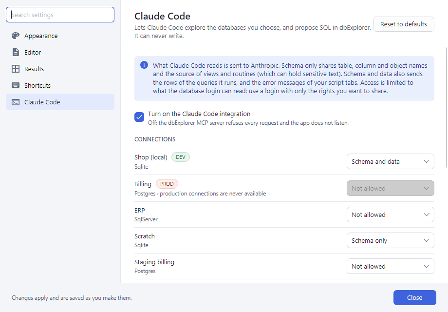
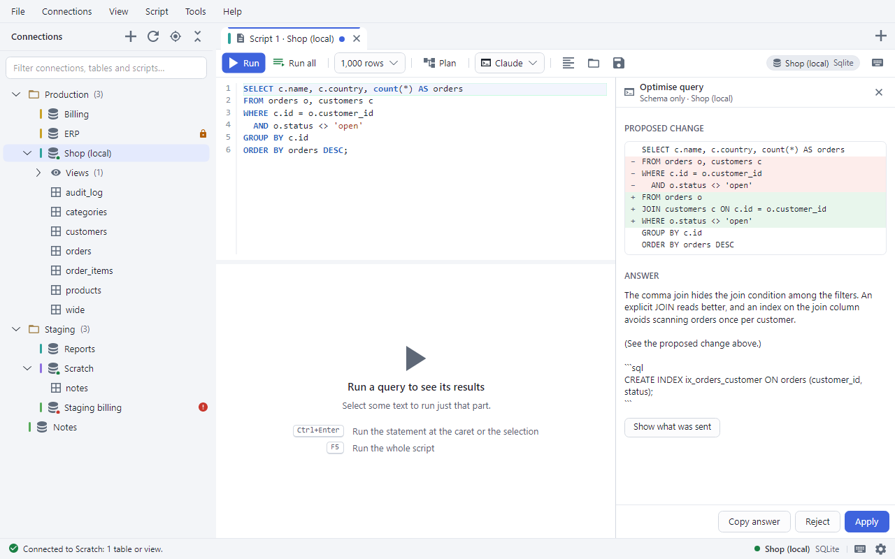

# Claude Code

dbExplorer can work with [Claude Code](https://code.claude.com): Claude Code explores the databases you choose, reads
definitions, runs read-only queries, asks for estimated plans, and opens SQL it proposes in a dbExplorer script tab.
It can never write.



## What leaves your machine

**Everything Claude Code reads through dbExplorer is sent to Anthropic**, as part of the conversation.

| Access | Sent to Anthropic when Claude asks |
| --- | --- |
| Schema only | connection name, engine, environment, database name; schema, table, view, routine and column names, types, keys and indexes; the source of views, procedures and functions (which can hold comments, literals or even credentials someone wrote there); estimated plans on SQL Server and SQLite; the SQL of the active script tab |
| Schema and data | the above, the rows returned by the queries it runs, estimated plans on PostgreSQL and MySQL, and the error of the active script tab's last run |

Estimated row counts in a plan come from the server's statistics, so they say something about the data even without data
access. Follow your organisation's rules about sharing names, source code and data with a third party.

## Turn it on

1. Tools > **Settings...** (`Ctrl+,`), page **Claude Code**.
2. Tick **Turn on the Claude Code integration** (off by default).
3. For each connection to share, choose **Schema only** or **Schema and data**. Every connection starts at **Not allowed**.
4. Tools > **Open in Claude Code** (also in the command palette, `Ctrl+Shift+K`).

Changes apply to the next request of a running session. Turning the integration off, or setting a connection to
**Not allowed**, cuts access at once.

A connection loses its choice when you point it at another server, database or login, or when you mark it as production:
choose again if that is still what you want. Imported and duplicated connections start at **Not allowed**.

**Production connections** ([Environments](environments.md)) are never available. There is no override.

### Open in Claude Code

Opens a PowerShell window running `claude` in your scripts repository: the Git repository that holds the
[dbupdate folder](database-upgrade.md) (that folder itself without Git), or the [script library](scripts.md#script-library)
when no dbupdate folder is set. The dbExplorer server is added for that session only, with
`--mcp-config <data folder>\claude\mcp.json`. Your own Claude Code configuration is not read or changed; your other MCP
servers stay available. The file holds the path of `DbExplorer.exe` and of the data folder, no secret.

If the `claude` command is not found (on `PATH` or in `%USERPROFILE%\.local\bin`), dbExplorer says so.

### In your own sessions

To have the tools in every Claude Code session, run the command shown on the settings page once:

```powershell
claude mcp add --scope user dbexplorer -- "<install folder>\DbExplorer.exe" --mcp --data-dir "<data folder>"
```

Remove it with `claude mcp remove dbexplorer`. dbExplorer never edits Claude Code's settings itself.

## Tools

| Tool | What it does | Needs |
| --- | --- | --- |
| `list_connections` | The allowed connections and their access level | integration on |
| `list_objects` | Tables, views, procedures and functions, with filters and paging | schema |
| `describe_object` | Columns, primary and foreign keys, indexes, referencing tables | schema |
| `get_definition` | Source of a view, procedure or function | schema |
| `explain` | Estimated execution plan of one `SELECT`; nothing runs | schema (SQL Server, SQLite), data (PostgreSQL, MySQL / MariaDB: they may evaluate parts of a statement while planning) |
| `query` | Runs one `SELECT` / `WITH` / `VALUES` and returns rows | data |
| `open_script_tab` | Opens proposed SQL in a new tab of the running app. Never executed | schema, app running |
| `get_active_tab` | SQL of the script tab in front, and its last error | schema (error: data), app running |

Limits of `query`: 100 rows by default, 1,000 at most; values cut at 2,000 characters; about 40,000 characters per result;
30 seconds by default, 120 at most; SQLite values over 4 MB are refused by the engine.

## Ask Claude from dbExplorer

With the integration on and a connection allowed, dbExplorer can also ask Claude itself, through `claude -p`. The answer
streams into a side panel. It uses your Claude Code sign-in and counts against your plan or API credit.



| Question | Where | What comes back |
| --- | --- | --- |
| Explain error | **Explain with Claude** on a failed statement, the **Claude** button of a script tab | Why it failed; a corrected text when a change fixes it |
| Optimise query | **Claude** button: the selection or the statement at the caret, with the plan and `STATISTICS IO` / `TIME` of the last run when it has them | A rewrite and index suggestions |
| Generate SQL | **Claude** button: describe what you want | SQL to insert at the caret or in place of the selection |
| Analyse plan | **Ask Claude** on an execution plan | The costly operators explained, index DDL as text |
| Review upgrade scripts | **Review with Claude** in the [Upgrade](database-upgrade.md) dialog, for the ticked scripts | Locks, long operations, statements that cannot run twice, data loss risks |

The same questions are in the command palette (`Ctrl+Shift+K`, "Claude:").

Proposed SQL is shown as a difference. **Apply** puts it in the editor as one undo step; **Reject** drops it. It is not
applied when the script or the database of the tab changed since the question. Nothing Claude writes is ever run, index
DDL included.

### What is sent

The first question of a connection shows the exact text, before anything is sent. It is shown again after you change the
access of that connection. Afterwards, **Show what was sent** unfolds it. Rows of tables are never part of a question.

| | Schema only | Schema and data |
| --- | --- | --- |
| SQL and upgrade scripts | string and number literals and comments replaced by placeholders (type sizes stay) | as written |
| Error message | only lines of a known shape, values replaced by `?`; the rest withheld | as shown |
| Execution plan | operators, objects, rows, costs, warning titles, missing index suggestions | also predicates and the other operator properties |
| Statistics | `STATISTICS IO` / `TIME` counters (other server messages never) | the same |
| Schema | names, columns, types, keys and indexes of the tables involved, when loaded | the same |
| Your description (Generate SQL) | as typed | as typed |

Placeholders are turned back into your values on your machine, in the proposed SQL. A proposal that holds a placeholder
that cannot be turned back cannot be applied. Stored secrets are masked. For several databases (an upgrade of a group), the
lowest access applies, and one database that is not allowed (production included) refuses the whole question.

### How Claude Code is run

`claude -p` with the question on standard input (never on the command line), in an empty folder of dbExplorer's data folder:

```text
--output-format stream-json --verbose --include-partial-messages
--safe-mode --tools "" --disallowedTools "*" --strict-mcp-config --disable-slash-commands
--no-session-persistence --no-chrome --permission-mode dontAsk --permission-prompts none --system-prompt <fixed text>
```

So it has no tool that could touch your machine, no MCP server, none of your hooks, plugins, skills or `CLAUDE.md`, and
saves no session. A run that announces a tool or an MCP server anyway (a managed policy) is stopped. **Stop**, closing the
panel, the tab or the window kills the whole process tree; a question is stopped after 5 minutes. A recent Claude Code is
needed (`claude update` when dbExplorer says it is too old). Questions are listed in the activity log (`ask:...`), without
their text.

## Safety

- **Off by default, connection by connection, schema only unless you say otherwise.** The server reads the settings again
  for every call; the app checks them again for the tab requests.
- **One `SELECT`, checked before it is sent.** Several statements, anything that may write, row locks, executable
  comments, control characters and functions that read server files, run SQL held in a string, take locks, signal other
  sessions or only wait are refused. A column that shares a refused word works when quoted.
- **Read-only at the engine too.** SQLite files are opened read-only with `query_only`; PostgreSQL and MySQL / MariaDB run
  in a read-only transaction (MySQL: read-only session); SQL Server has no read-only mode: the statement runs in a
  transaction that is always rolled back.
- **Object names are looked up, never pasted into SQL.**
- **Other databases of the server.** On SQL Server and MySQL / MariaDB, a query naming the database of a connection that
  may not give data (production included) is refused, as are four-part (linked server) names.
- **Secrets.** Passwords, client secrets, SSH passwords and passphrases and TLS key passphrases are never part of a tool;
  as a last check they are masked (`***`) in every reply and log line.
- **No silent prompts.** A connection that signs in interactively (Microsoft Entra with MFA) cannot be opened by Claude
  Code. An SSH server whose host key you have not accepted in the app is refused: connect to it once in dbExplorer.
- **Questions from the app** have their own rules: see [Ask Claude](#ask-claude-from-dbexplorer).
- **Proposed SQL is only shown.** The tab starts with a comment saying so, is never run by dbExplorer, and does not take
  the front while you are working in the window. Line breaks and invisible or text-reordering characters are normalised so
  that what you read is what would run. Running it is your own action, with your own rights: read it first.
- **Activity log.** Every call, with its connection, SQL or object name and outcome (never the returned data), is listed on
  the settings page (`claude-activity.jsonl` in the data folder, about 1 MB kept twice). A call that cannot be logged
  returns nothing.
- **Local only.** The server talks to Claude Code over standard input and output. It reaches the running app through a
  named pipe that only your Windows account may open and that refuses network logons. Nothing listens on the network.

## What this does not protect against

- **The database login is the real boundary.** The checks read the text of a statement. A user-defined function, a view,
  a synonym, a foreign table or a trigger can reach more than the text shows (another database, a remote server, a side
  effect a rollback does not undo). Give Claude Code a connection whose login has only the rights you want to share.
- **Claude Code itself.** Its terminal can run commands as you do, subject to its own permission prompts, including
  reading files of your account. The settings above limit the dbExplorer tools, not the rest of the session.
- **Text from the database.** Names, comments, definitions and rows can hold instructions aimed at an AI. The server tells
  Claude to treat them as data; review what it proposes.
- **Two dbExplorer windows** each keep their own copy of the settings: one saving can restore a choice changed in the other.
  Only the first window answers the tab requests.

## How it is built

`DbExplorer.exe --mcp` is the server ([MCP](https://modelcontextprotocol.io), official C# SDK
`ModelContextProtocol.Core`). It is the same executable as the app, so releases and updates carry it, and nothing of it is
loaded when the app starts. An update goes through while a server is running; restart that Claude Code session
afterwards. Logic is in `src/DbExplorer.Core/Claude/`.
