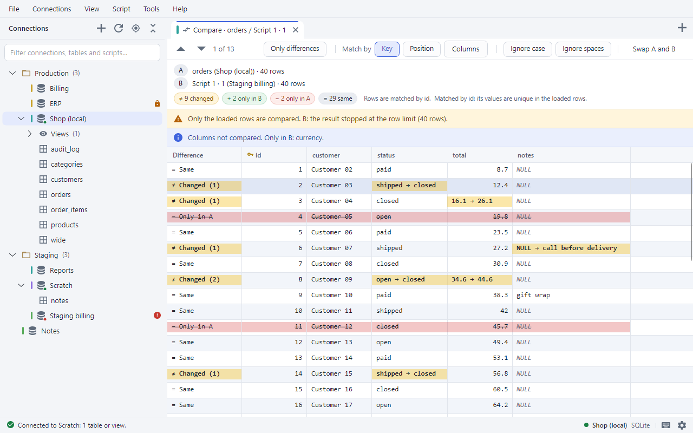

# Compare results

Compare the rows of two results: two query results, two table tabs, or a table and a query, on the same connection or on
two different ones.

## Start a comparison

1. Right-click a cell of the first result and choose **Select for compare**. This is side **A**.
2. Right-click a cell of the second result and choose **Compare with selected**. This is side **B**.

The two results can be in the same script (switch to the other result tab), in two tabs, or on two connections. Both
commands are also in the [command palette](features.md#command-palette) (`Ctrl+Shift+K`, category Compare). A selected
result stays selected, so several others can be compared with it.

The comparison opens in its own tab. It works on a copy of the rows as the grids showed them: running the script or
reloading the table afterwards does not change it, and comparing sends nothing to a database.

**Only loaded rows are compared.** A banner says so when a script result stopped at the row limit, or when a table tab
holds only one page. To compare more, raise the limit (or write a query that returns the rows wanted) and compare again.

## Matching rows

- **Key**: rows with the same values in the key columns are paired. The key is proposed from the primary key, else from a
  column (or two) whose values are unique on both sides; a line above the grid says which and why. Change it under
  **Columns**.
- **Position**: the first row with the first row, and so on. Used when no column identifies the rows.

When several rows share a key, a warning counts them and shows examples; they are paired in order of appearance.

## Columns and values

Columns are matched by name, ignoring case. A column that only one side has is listed and not compared. Under
**Columns**, untick **Compare** to leave a column out (a timestamp, for example).

Values are compared by value, not by type: `int`, `bigint` and `decimal` 5 are equal, and so are a date or a GUID held
as text (SQLite) and a typed one. NULL equals only NULL. **Ignore case** and **Ignore spaces** (leading, trailing and
repeated white space) apply to text, in key columns too. Columns whose types differ are listed under the grid.

## Reading the result

| Row | Shown as |
| --- | --- |
| Same in A and B | `= Same` |
| Same key, different values | `≠ Changed (n)`; each changed cell is bold and reads `A value → B value` |
| Only in A | `− Only in A`, struck through |
| Only in B | `+ Only in B` |

The counts are above the grid. **Only differences** hides the equal rows. `F8` / `Shift+F8` go to the next / previous
difference. **Swap A and B** compares the other way round. Copy and export work as on any grid
([Copy and export](export.md)). A long comparison can be cancelled.

This is different from the [group run](groups.md) differences, which runs one query on every database of a group and
lists the rows that are not identical everywhere.
