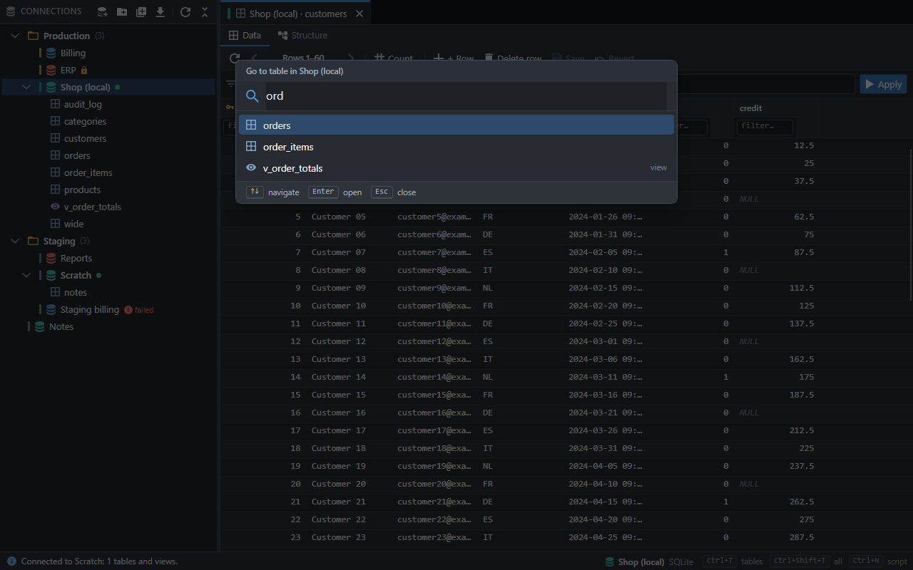

# Features

What dbExplorer does day to day: browsing, filtering and editing data, jumping around, running SQL, and coming back
where you left off. The big topics have their own page: [linked database groups](groups.md), [scripts](scripts.md),
[execution plans and statistics](plans.md), [database upgrade](database-upgrade.md), [DBeaver import](dbeaver-import.md).

## Connection tree

Folders (one level) > connection > schema > tables (SQLite has no schema level). Several
connections stay connected at once, one session each. Drag a connection into a folder; add, rename, edit, delete.
Reorder folders by dragging one above or below another (a line shows where it lands), or with **Move up** / **Move down**
in the folder's context menu; the order is saved.

### Views, procedures and functions

Above the tables of a schema (of the connection for SQLite) sit up to three groups:

- **Views** (materialized views included): a double-click opens the data, as for a table, with the columns in the
  Structure sub-tab.
- **Procedures** and **Functions** (SQL Server and PostgreSQL; SQLite has neither): listed when a group is first expanded.
  PostgreSQL shows the argument types, which tell overloads apart.

**Open definition** (context menu of a view; double-click or `Enter` on a procedure or function) shows the source text in
a new script tab. Nothing is executed. The tab is not unsaved work: it closes without a question and is not restored at
the next start, unless you edit or save it. When the database gives no text (encrypted object, missing permission, CLR
routine, object dropped meanwhile) the status bar says which.

The procedures and functions are read in the background once the tables are shown, so connecting is not slower; a schema
that holds only routines appears at that moment. **Refresh** reads them again. The navigator filter finds views, and the
procedures and functions of the groups you have expanded.

A **Groups** section at the top lists the linked database groups (see [Linked database groups](groups.md)).

Import from DBeaver: folders, connections, credentials and virtual keys, see [DBeaver import](dbeaver-import.md).

## Table tabs

Table tabs are labelled `connection · table` with a colour chip per connection, each with two sub-tabs:

- **Data**: pages of 200 rows (OFFSET paging), total row count only on demand (Count button), column sort,
  per-column filter row (`contains` by default, `=`, `!=`, `<`, `>`, `null`, `!null`, `in (a,b)`, combined with AND),
  "filter by this value" from the cell context menu, and a raw `WHERE` box. Filters run server-side with parameters.
- **Structure**: columns, types, nullability, primary key, foreign keys, indexes.

**Follow foreign keys**: `Ctrl+click` (or double-click) an FK value to open the referenced row in a new tab.

**Copy and export**: table and script grids copy the selected rows, cells or columns (also as CSV, JSON, Markdown or SQL)
and export them, or every row of the query, to a file. [Copy and export](export.md)

## Command palette

`Ctrl+Shift+K` (or View > Command palette...) lists every command of the app in one searchable box.

- The search tolerates typos (the quick open ranking), also matches the category and keywords ("dark" finds Change theme),
  and takes words in any order. The matched letters are in bold.
- Each row shows its category and keyboard shortcut. A command that cannot run now stays listed, greyed, with the reason
  ("Open a script tab first").
- With an empty box: the commands used last (remembered), then what fits the current tab (script, plan, table, diagram),
  then the rest.
- The grid on screen can be copied and exported from it (Copy, Copy with headers, Advanced copy, Copy as, Export).
- A command that needs a choice (Connect to..., Switch to tab..., Change theme...) lists it inside the palette; `Backspace` on
  an empty box goes back.
- `Up` / `Down`, `PageUp` / `PageDown`, `Home` / `End`, `Enter`, `Esc`, or the mouse. Closing gives the focus back to where it was.

## Quick open

Fuzzy-search the tables, views, procedures, functions and columns of the active connection (`Ctrl+T`) or of all
connections (`Ctrl+Shift+P`, served from an on-disk metadata cache, never connects by itself); `Ctrl+L` jumps to a column
in the current table. **Enter** opens a table or view, the definition of a procedure or function, or the table of a column,
positioned on that column. Each row shows its kind's icon and its parent (schema, table, connection).

The chips under the search box switch each kind off and on (mouse, `Alt+1` to `Alt+5`, or `Shift+Tab` then `Space`); the
choice is remembered. Columns show once you type, and never push the tables out: at equal match quality objects come first,
and a column rises above them only when its name fits what you typed better. Type `orders.total` to search a column within a
table.

The search forgives typos in table, view and routine names (a wrong, extra or missing letter, two letters swapped; from 4
letters on; not in column names), exact matches rank first, and `Ctrl+T` reopens with the text you typed last time,
selected (type to replace it, Enter to reuse it).

## Row editing

Edits are staged in the grid (highlighted), `Ctrl+S` shows the generated SQL, then applies it in one
transaction. Insert and delete rows. Tables without a primary key are read-only until you define "virtual key"
columns for them (persisted, like DBeaver's virtual PK). Edit is disabled on connections flagged read-only.

## Script runner

A SQL editor tab per connection (AvaloniaEdit, syntax highlighting). `F5` runs the whole script,
split on `;` (respecting quotes, comments and `$$` bodies) and on `GO` lines for SQL Server. `Ctrl+Enter` with nothing
selected runs the statement under the cursor, which also ends at a **blank line** (outside strings, comments and `$$`
bodies; T-SQL needs no `;`), so a SELECT followed by a blank line and an UPDATE never run together; a cursor on a blank
line runs the statement above it. A selection runs as selected (split by `;`/`GO` only). One result grid per result
set, rows affected and duration, cancel button, and a "Rows" limit box (default 1000, up to 100 000): a result cut at
the limit says so, raise the limit and run again. Honours the connection read-only flag. Scripts are plain files;
unsaved editor contents are restored at the next start: from the saved tab list, plus any autosave copy written after it
(e.g. after a crash); older copies the list does not mention stay in `scripts\` and the status bar says how many.

More on scripts (library, history, formatting, search): [Scripts](scripts.md). Plans and statistics: [Execution plans and statistics](plans.md).

## ER diagrams

**ER diagram** in the navigator's context menu draws the tables and the foreign keys between them: on a connection the whole
database, on a schema that schema (the toolbar's schema filter adds others), on a table that table and its neighbours, with
an adjustable depth (1 to 9 keys away, followed in both directions). Views are not drawn.

- Each card lists the columns with their types; a key icon marks the primary key, `FK` (and the link colour) a foreign key.
  The **Columns** switch shows all columns, keys only, or table names only.
- Relations: a crow's foot on the referencing side (a bar when its key is unique), a bar on the referenced side. A key that
  accepts `NULL` is dashed and has a ring.
- The layout puts referenced tables on the left and unlinked tables in a block of their own; cycles and self references are
  fine. **Arrange** lays out again after tables were dragged.
- The canvas works like the execution plan: drag the background to pan, wheel to zoom around the cursor, **Fit**. Below
  45% the cards show names only; only what is in view is drawn, so hundreds of tables stay usable.
- Hover a table to highlight its relations, drag it to move it, search by name (`Ctrl+F`) to centre it, double-click it to
  open its data. Right-click: open, show its neighbours, copy the name.
- **Export PNG** saves the whole diagram with the current theme and column choice.
- Opening a diagram uses the schema read when the connection was opened; the reload button reads the catalog again. Nothing
  is ever written.

## One connection per script tab

The tab opens its own connection on its first run and keeps it, so `BEGIN TRAN`,
temp tables (`#t`), variables and `SET` options survive from one run to the next, and `ROLLBACK`/`COMMIT` in a later run
works. It is released when the tab closes (a transaction still open is rolled back), on Disconnect, when the connection
is edited, or when it is found broken; the next run then reconnects and the status bar says the session state was reset.

## Tabs survive closing the app

The open tabs come back at the next start, in the same order and with the same tab
active: tables (with the connection they are on now, so a tab switched to another group member returns on that member,
plus column filters, WHERE and sort) and scripts (connection, file, and any unsaved text from the autosave). Only the
active table tab loads at start (it connects and reads its first page in the background, after the window is shown);
every other restored table tab loads, connecting if needed, the first time you select it, and scripts connect only when
they run. Nothing connects before the first paint. A tab whose connection was deleted is skipped; one that cannot
connect shows the usual error with Reload. Tabs you closed yourself are not restored (and neither is a script you chose
Discard for when closing the window); the Ctrl+Shift+T history of closed tabs is not kept across runs. The list is saved
about a second after every change and when the window closes, in `session.json`. To start with no tabs, delete that file:
the app then restores only the unsaved scripts, as before. A script whose autosave copy or file cannot be read is not
opened as an empty dirty tab: its copy stays on disk, or it opens empty and unlinked from the file, with a message.

## Groups, upgrade, safety and theme

- **Linked database groups**: link databases that share one schema (dev, preprod, customer copies) into a named group, switch a tab between them with one key press, run the same read-only query on all of them at once and see where the results differ, or compare their schemas. Details, shortcuts and limits: [Linked database groups](groups.md).
- **Database upgrade**: play the dbupdate scripts of one sprint of the repository on the current database or on a whole group, with a preview, warnings (index creation, long-running statements) and a confirmation. Gear menu: **Settings...** and **Upgrade database...**. Details: [Database upgrade](database-upgrade.md).
- **Safety**: nothing is written without an explicit save; passwords are stored encrypted with Windows DPAPI (current user); SQL Server connections expose `encrypt` and `trustServerCertificate`.
- Light/dark theme follows Windows (or the choice made in [Settings](settings.md)).
