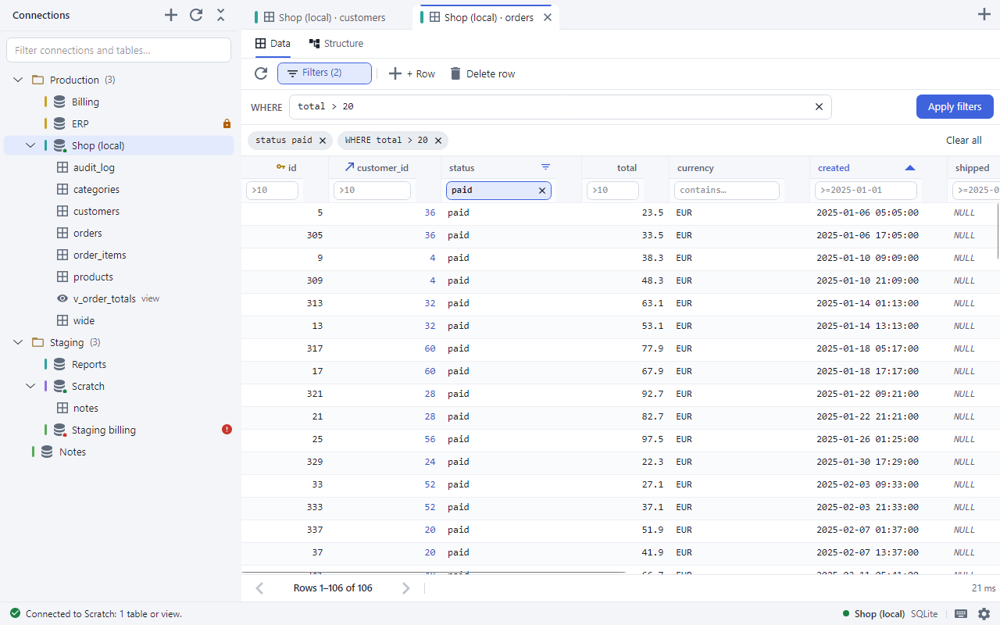
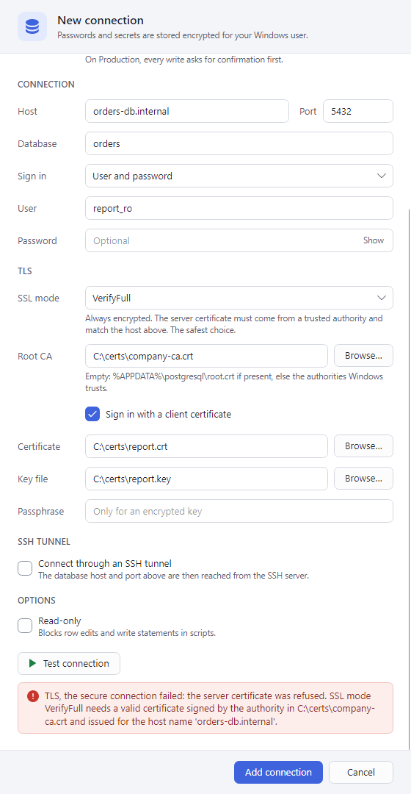
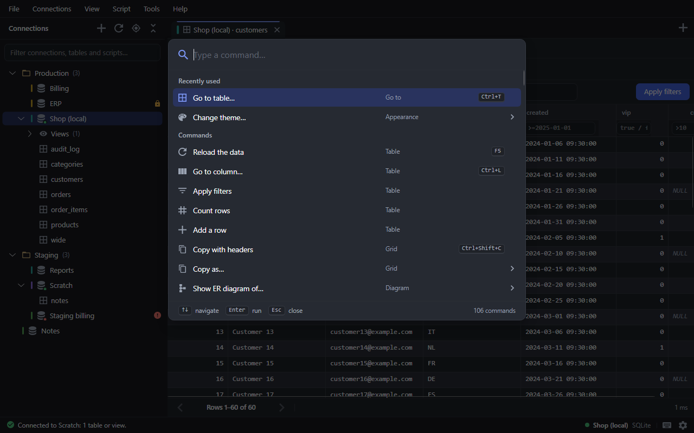
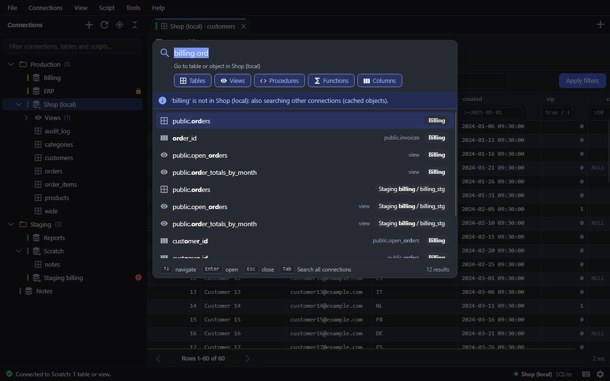
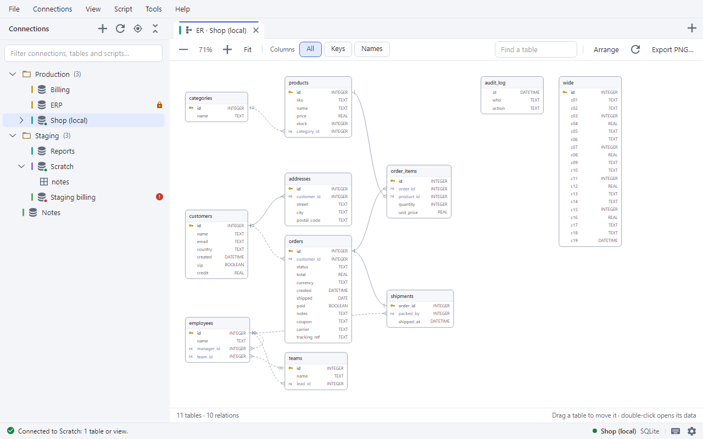

# Features

What dbExplorer does day to day: browsing, filtering and editing data, jumping around, running SQL, and coming back
where you left off. The big topics have their own page: [linked database groups](groups.md), [scripts](scripts.md),
[execution plans and statistics](plans.md), [database upgrade](database-upgrade.md), [DBeaver import](dbeaver-import.md),
[compare results](compare.md).

## Sign-in and SSH tunnels

The connection dialog shows only the fields the chosen sign-in needs. **Test connection** goes the same way as a real
connection and says which step failed: SSH server, host key, SSH sign-in, forwarding to the database, TLS, database
sign-in or database.

| Engine | Sign in | Asks for |
| --- | --- | --- |
| PostgreSQL | User and password | user, password |
| PostgreSQL | Windows (SSPI / Kerberos) | optionally a role name |
| MySQL / MariaDB | User and password | user, password |
| MySQL / MariaDB | Windows (MariaDB GSSAPI) | optionally a user name; needs the server's gssapi plugin |
| SQL Server | SQL Server login | user, password |
| SQL Server | Windows | nothing |
| SQL Server | Microsoft Entra: interactive (MFA) | optionally the account; a Microsoft sign-in window opens |
| SQL Server | Microsoft Entra: default credential | optionally a managed identity client ID |
| SQL Server | Microsoft Entra: integrated | optionally the account |
| SQL Server | Microsoft Entra: password | account, password |
| SQL Server | Microsoft Entra: service principal | client ID, client secret |

Choosing a Microsoft Entra mode ticks **Encrypt connection**. The Entra libraries are only loaded when a SQL Server
connection is used, the SSH library when a tunnel opens: nothing more happens at start-up.

**SSH tunnel** (PostgreSQL, SQL Server, MySQL and MariaDB): sign in to an SSH server with a password or a private key (with its passphrase);
the database host and port are then resolved from that server. Each open connection owns one tunnel, listening on a free
port of `127.0.0.1`; it closes with the connection and is reopened by the next operation when it dropped (a script tab
says it reconnected: an open transaction is lost). The server certificate is still checked against the database host name.

**Host keys**: the first connection to an SSH server shows its SHA-256 fingerprint; only **Trust and connect** stores it
(`ssh_known_hosts.json`, Cancel is the default). A server that later presents another key is refused without a question; if
it was really reinstalled, remove its entry from that file. SSH passwords, passphrases and client secrets are encrypted like
database passwords.

## PostgreSQL TLS

**SSL mode** in the connection dialog. The default, **Prefer**, is what the driver does by itself: a new connection and a
connection saved by an older version behave alike. It does not check the server certificate, so servers with a self-signed
certificate keep working; the dialog says that the server is not verified. Choose **VerifyFull** wherever the server has a
certificate you can check.

| SSL mode | Encrypted | Server certificate |
| --- | --- | --- |
| Disable | no | not checked |
| Allow | only if the server insists | not checked |
| Prefer (default) | if the server offers it | not checked |
| Require | always | not checked |
| VerifyCA | always | must chain to a trusted authority; any host name |
| VerifyFull | always | must chain to a trusted authority and name the connection's host |

- **Root CA** (verifying modes): a PEM file with the authority that signed the server certificate. Empty:
  `%APPDATA%\postgresql\root.crt` if present (or `PGSSLROOTCERT`), else the authorities Windows trusts. VerifyCA without
  a root CA file is flagged: a certificate issued for any host name passes.
- **Client certificate**: a PEM certificate with its key file (or both in one file), or a `.pfx`. The passphrase of an
  encrypted key is stored like the database password. Revocation is not checked.
- Through an SSH tunnel, TLS still names the connection's database host (not `127.0.0.1`), so VerifyFull works.
- Require, VerifyCA and VerifyFull turn GSS (Kerberos) encryption off, which would otherwise take the place of TLS.
  Windows sign-in still works.
- Paths may use environment variables (`%USERPROFILE%\certs\ca.crt`).

## MySQL and MariaDB

One engine in the dialog for both; the app tells them apart by the server version. A connection is one database: the tree
lists its tables directly (no schema level). The driver (MySqlConnector) is only loaded when such a connection is used.

**TLS** uses the same fields as PostgreSQL, without **Allow** (MySQL has none). Empty **Root CA**: the authorities Windows
trusts. A client certificate is a PEM certificate with an unencrypted key, or a `.pfx` with its passphrase. Through an SSH
tunnel, VerifyFull checks the certificate against the connection's database host.

**Scripts** understand backticks, `#` comments, `--` followed by a blank, backslash escapes, and the `DELIMITER` lines of
the mysql client (never sent; a blank line does not end a statement under a custom delimiter). Warnings and notes appear in
the Messages tab (not read for a script that calls `FOUND_ROWS()`). `0000-00-00` dates read as `0001-01-01`.

**Read-only** connections are enforced twice. The guard refuses anything not provably a read, under every way `sql_mode`
may read the quotes, and any executable comment (`/*! ... */`, `/*M! ... */`). The server session is set to `TRANSACTION
READ ONLY` (so a DDL statement's implicit commit changes nothing), `sql_mode` loses the modes that change quoting
(`ANSI_QUOTES`, `NO_BACKSLASH_ESCAPES`...), and every run is a transaction that is rolled back.

## Connection tree

Folders (one level) > connection > schema > tables (SQLite, MySQL and MariaDB have no schema level). Several
connections stay connected at once, one session each. Drag a connection into a folder; add, rename, edit, delete.
Reorder folders by dragging one above or below another (a line shows where it lands), or with **Move up** / **Move down**
in the folder's context menu; the order is saved.

### Views, procedures and functions

Above the tables of a schema (of the connection for SQLite) sit up to three groups:

- **Views** (materialized views included): a double-click opens the data, as for a table, with the columns in the
  Structure sub-tab.
- **Procedures** and **Functions** (SQL Server, PostgreSQL, MySQL and MariaDB; SQLite has neither): listed when a group is first expanded.
  PostgreSQL shows the argument types, which tell overloads apart.

**Open definition** (context menu of a view; double-click or `Enter` on a procedure or function) shows the source text in
a new script tab. Nothing is executed. The tab is not unsaved work: it closes without a question and is not restored at
the next start, unless you edit or save it. When the database gives no text (encrypted object, missing permission, CLR
routine, object dropped meanwhile) the status bar says which.

The procedures and functions are read in the background once the tables are shown, so connecting is not slower; a schema
that holds only routines appears at that moment. **Refresh** reads them again. The navigator filter finds views, and the
procedures and functions of the groups you have expanded.

A **Groups** section at the top lists the linked database groups (see [Linked database groups](groups.md)).

Import from DBeaver: folders, connections, credentials and virtual keys, see [DBeaver import](dbeaver-import.md).

## Table tabs

Table tabs are labelled `connection · table` with a colour chip per connection, each with two sub-tabs:

- **Data**: pages of 200 rows (OFFSET paging), total row count only on demand (Count button), column sort,
  per-column filter row (`contains` by default, `=`, `!=`, `<`, `>`, `null`, `!null`, `in (a,b)`, combined with AND),
  "filter by this value" from the cell context menu, and a raw `WHERE` box. Filters run server-side with parameters.
- **Structure**: columns, types, nullability, primary key, foreign keys, indexes.

**Follow foreign keys**: `Ctrl+click` (or double-click) an FK value to open the referenced row in a new tab.

**Copy and export**: table and script grids copy the selected rows, cells or columns (also as CSV, JSON, Markdown or SQL)
and export them, or every row of the query, to a file. [Copy and export](export.md)

**Compare results**: right-click a table or query result, **Select for compare**, then **Compare with selected** on
another one, across tabs and connections. [Compare results](compare.md)

## Command palette

`Ctrl+Shift+K` (or View > Command palette...) lists every command of the app in one searchable box.

- The search tolerates typos (the quick open ranking), also matches the category and keywords ("dark" finds Change theme),
  and takes words in any order. The matched letters are in bold.
- Each row shows its category and keyboard shortcut. A command that cannot run now stays listed, greyed, with the reason
  ("Open a script tab first").
- With an empty box: the commands used last (remembered), then what fits the current tab (script, plan, table, diagram),
  then the rest.
- The grid on screen can be copied and exported from it (Copy, Copy with headers, Advanced copy, Copy as, Export).
- A command that needs a choice (Connect to..., Switch to tab..., Change theme...) lists it inside the palette; `Backspace` on
  an empty box goes back.
- `Up` / `Down`, `PageUp` / `PageDown`, `Home` / `End`, `Enter`, `Esc`, or the mouse. Closing gives the focus back to where it was.

## Quick open

Fuzzy-search the tables, views, procedures, functions and columns of the active connection (`Ctrl+T`) or of all
connections (`Ctrl+Shift+P`, served from an on-disk metadata cache, never connects by itself); `Ctrl+L` jumps to a column
in the current table. **Enter** opens a table or view, the definition of a procedure or function, or the table of a column,
positioned on that column. Each row shows its kind's icon and its parent (schema, table, connection).

Type several words, separated by spaces, in any order: `accounts resto2` and `resto2 accounts` both find the table
`accounts` of the database `resto2`. Each word must match something of a row: the name of the object, its schema, the
table of a column, the database (the file name for SQLite), the connection, its folder, its linked groups or its
environment (`prod`, `staging`...). Partial words work (`acc resto2`), `schema.table` still works as one word, and typing
mistakes are forgiven in object, connection, database, folder and group names. Rows whose name is a typed word come first,
then rows whose name contains one, then the others: a database name alone lists the objects of that database, tables first.
A column is listed only when one word matches its own name. A connection holds one database: databases that go together are
the members of a [linked group](groups.md), found by their database, connection or group name.

`Ctrl+T` stays on the active connection until a word names another connection or database (or folder, group, environment)
that this one cannot satisfy: no name here contains it, or the query finds nothing here. It then also searches the cached
objects of the other connections, says so above the list, and shows where each row is. It connects only when you choose a
row, which opens in its own connection. At equal match quality the active connection comes first. A connection never opened
has no cache and the banner says so.

The chips under the search box switch each kind off and on (mouse, `Alt+1` to `Alt+5`, or `Shift+Tab` then `Space`); the
choice is remembered. Columns show once you type, and never push the tables out: at equal match quality objects come first,
and a column rises above them only when its name fits what you typed better. Type `orders.total` to search a column within a
table.

The search forgives typos in table, view and routine names (a wrong, extra or missing letter, two letters swapped; from 4
letters on; not in column names), exact matches rank first, and `Ctrl+T` reopens with the text you typed last time,
selected (type to replace it, Enter to reuse it).

## Row editing

Edits are staged in the grid (highlighted), `Ctrl+S` shows the generated SQL, then applies it in one
transaction. Insert and delete rows. Tables without a primary key are read-only until you define "virtual key"
columns for them (persisted, like DBeaver's virtual PK). Edit is disabled on connections flagged read-only.

Connections marked **Production** ask for confirmation before any write: [environments](environments.md).

## Script runner

A SQL editor tab per connection (AvaloniaEdit, syntax highlighting). `F5` runs the whole script,
split on `;` (respecting quotes, comments and `$$` bodies) and on `GO` lines for SQL Server (MySQL: `DELIMITER` lines too). `Ctrl+Enter` with nothing
selected runs the statement under the cursor, which also ends at a **blank line** (outside strings, comments and `$$`
bodies; T-SQL needs no `;`), so a SELECT followed by a blank line and an UPDATE never run together; a cursor on a blank
line runs the statement above it. A selection runs as selected (split by `;`/`GO` only). One result grid per result
set, rows affected and duration, cancel button, and a "Rows" limit box (default 1000, up to 100 000): a result cut at
the limit says so, raise the limit and run again. Honours the connection read-only flag. Scripts are plain files;
unsaved editor contents are restored at the next start: from the saved tab list, plus any autosave copy written after it
(e.g. after a crash); older copies the list does not mention stay in `scripts\` and the status bar says how many.

A statement that returns no result set, no row count and no error (`DECLARE`, `SET`, `USE`, DDL) gets no result tab; it
still counts in the run summary and keeps its gutter mark. A run with nothing to show says it completed. Server messages
(`PRINT`, PostgreSQL notices, MySQL warnings) appear in a Messages tab. T-SQL variables live in their batch, so `F5` and a selection send
a SQL Server batch that declares a variable as a whole (one statement, split at `GO` only; all its rows are read, so a
result cut at the row limit does not stop what follows). `Ctrl+Enter` at the cursor still runs one statement: select the
lines to run a `DECLARE` with its use.

Brackets and quotes surround the selection or close themselves: [Typing in the editor](scripts.md#typing-in-the-editor).

More on scripts (library, history, formatting, search): [Scripts](scripts.md). Plans and statistics: [Execution plans and statistics](plans.md).

## ER diagrams

**ER diagram** in the navigator's context menu draws the tables and the foreign keys between them: on a connection the whole
database, on a schema that schema (the toolbar's schema filter adds others), on a table that table and its neighbours, with
an adjustable depth (1 to 9 keys away, followed in both directions). Views are not drawn.

- Each card lists the columns with their types; a key icon marks the primary key, `FK` (and the link colour) a foreign key.
  The **Columns** switch shows all columns, keys only, or table names only.
- Relations: a crow's foot on the referencing side (a bar when its key is unique), a bar on the referenced side. A key that
  accepts `NULL` is dashed and has a ring.
- The layout puts referenced tables on the left and unlinked tables in a block of their own; cycles and self references are
  fine. **Arrange** lays out again after tables were dragged.
- The canvas works like the execution plan: drag the background to pan, wheel to zoom around the cursor, **Fit**. Below
  45% the cards show names only; only what is in view is drawn, so hundreds of tables stay usable.
- Hover a table to highlight its relations, drag it to move it, search by name (`Ctrl+F`) to centre it, double-click it to
  open its data. Right-click: open, show its neighbours, copy the name.
- **Export PNG** saves the whole diagram with the current theme and column choice.
- Opening a diagram uses the schema read when the connection was opened; the reload button reads the catalog again. Nothing
  is ever written.

## One connection per script tab

The tab opens its own connection on its first run and keeps it, so `BEGIN TRAN`,
temp tables (`#t`), variables and `SET` options survive from one run to the next, and `ROLLBACK`/`COMMIT` in a later run
works. It is released when the tab closes (a transaction still open is rolled back), on Disconnect, when the connection
is edited, or when it is found broken; the next run then reconnects and the status bar says the session state was reset.

## Tabs survive closing the app

The open tabs come back at the next start, in the same order and with the same tab
active: tables (with the connection they are on now, so a tab switched to another group member returns on that member,
plus column filters, WHERE and sort) and scripts (connection, file, and any unsaved text from the autosave). Only the
active table tab loads at start (it connects and reads its first page in the background, after the window is shown);
every other restored table tab loads, connecting if needed, the first time you select it, and scripts connect only when
they run. Nothing connects before the first paint. A tab whose connection was deleted is skipped; one that cannot
connect shows the usual error with Reload. Tabs you closed yourself are not restored (and neither is a script you chose
Discard for when closing the window); the Ctrl+Shift+T history of closed tabs is not kept across runs. The list is saved
about a second after every change and when the window closes, in `session.json`. To start with no tabs, delete that file:
the app then restores only the unsaved scripts, as before. A script whose autosave copy or file cannot be read is not
opened as an empty dirty tab: its copy stays on disk, or it opens empty and unlinked from the file, with a message.

## Groups, upgrade, safety and theme

- **Linked database groups**: link databases that share one schema (dev, preprod, customer copies) into a named group, switch a tab between them with one key press, run the same read-only query on all of them at once and see where the results differ, or compare their schemas. Details, shortcuts and limits: [Linked database groups](groups.md).
- **Database upgrade**: play the dbupdate scripts of one sprint of the repository on the current database or on a whole group, with a preview, warnings (index creation, long-running statements) and a confirmation. Gear menu: **Settings...** and **Upgrade database...**. Details: [Database upgrade](database-upgrade.md).
- **Safety**: nothing is written without an explicit save; passwords are stored encrypted with Windows DPAPI (current user); SQL Server connections expose `encrypt` and `trustServerCertificate`.
- Light/dark theme follows Windows (or the choice made in [Settings](settings.md)).
