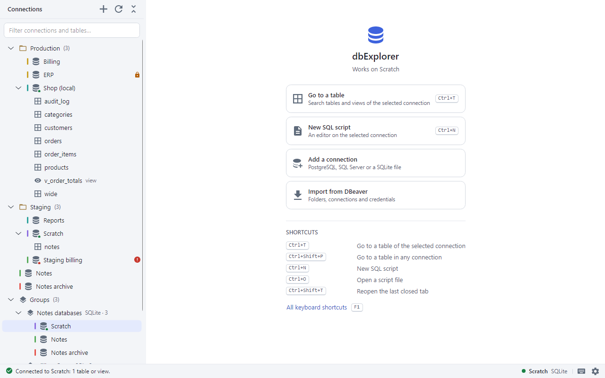

# Linked database groups

Link databases that share one schema (dev, preprod, customer copies) into a named group, switch a tab between them with
one key press, run the same read-only query on all of them at once and see where the results differ, or compare their
schemas.

A **group** is a named, ordered list of connections that have the same schema and the **same engine** (all PostgreSQL, all SQL
Server or all SQLite). It only references connections: credentials and the read-only flag stay on each connection, a
connection can be in several groups, and deleting a connection removes it from its groups. Groups are stored in `config.json`
(an older file without groups loads unchanged).

**In the navigator.** The **Groups** section (it appears once a group exists) lists each group with its engine and member
count; a group expands to its members, which are shortcuts to the real connections (double-click connects one). Create a group
with the **New group** button of the navigator toolbar or from a group's menu; a connection's menu has **Add to group...**
(one of the groups it could join, or a new group started with it). A group's menu: **Check schema differences**, **Edit
group...**, **Rename...**, **Delete group** (the connections are kept) and **New group...**; a member's menu: **Connect** and
**Remove from group**.

**Group editor.** A name plus two lists: the available connections and the members in order (add, remove, move up / down;
double-click moves an entry). The first member fixes the engine, and only connections of that engine are offered afterwards.
Saving is refused for an empty or duplicate name. A group with fewer than two members can be saved (a banner says it needs two
to switch or compare); it just has no selector and no run on group.

**Schema-difference report** (group menu, **Check schema differences**). Connects to every member (4 at a time, with the
status-bar spinner and Cancel), reads their schemas and shows, for each database against the rest of the group: missing and
extra tables / views, missing and extra columns, columns whose data type differs, and an object that is a table in some
databases and a view in others. Indexes, keys and constraints are not compared. A database that cannot be reached is listed
in the report and never stops the others. Informational only; the connections it opened stay open in the navigator.

**Switching a tab between members.** A table or script tab whose connection is in a group with other members shows a database
selector (group icon, previous / next chevrons and a list of the group's databases; a group picker too when the connection is
in several groups). `Ctrl+Alt+PageDown` / `Ctrl+Alt+PageUp` move to the next / previous database of the group, wrapping around.

- A **table tab** reloads the same table on the other database with the same filters, raw `WHERE` and sort, from page 0.
  Pending edits go through the usual Save / Discard / Cancel question first. If the other database cannot be reached or has no
  such table, an error strip says so and the tab stays exactly as it was (edits you chose to discard stay discarded).
- A **script tab** keeps its text and its results; the next run uses the other database. Its own dedicated connection to the
  old database is released at the switch, so a transaction left open there is rolled back (as when the tab closes).
- A switch is refused while a script or a group run is running in that tab.

**Run on group** (script tab on a connection that is in a group; the "Run on group" and "Script on group" buttons only show
then). `Ctrl+Shift+Enter` runs the selection or the statement under the cursor (same rules as `Ctrl+Enter`), `Ctrl+Shift+F5`
the whole script, on every database of the group at the same time (4 at a time, not configurable), with the tab's row limit
applied per database. A status panel lists every database as waiting, running, done (rows and time), failed (with its error)
or cancelled, with a Cancel button on each line and **Cancel all** (`Ctrl+Break` too). One slow, unreachable or failing
database never blocks the others. The results:

- **All**: the rows of every database in one grid with a leading `Database` column, merged on the columns that all databases
  have (a notice names the columns that were left out).
- **Differences only** (check box on the All tab): only the rows that are not identical in every database, with a leading
  `Present in` column naming the databases that have the row (`name×2` when a database has it twice). Rows are compared on all
  their values, NULLs included; numbers, dates and GUIDs are compared by value across engines.
- **One tab per database**: that database's own result grid (or its error) for the compared statement.
- A database that failed, was cancelled or returned no columns is left out of All and Differences and named in a notice. A
  result cut at the row limit says so, and warns that the differences may then be false.

**Read-only guarantee.** A group run is read and compare only. Every statement goes through the engine-aware read-only guard
and every database runs in a read-only context, **whatever the read-only flag of each connection says**: a connection that is
editable on its own is still read-only in a group run. It is exactly as strong as the read-only mode of an ordinary connection
(see [Known limitations](limitations.md): a lexical guard that does not know functions with side effects, plus a database-enforced read-only
context on PostgreSQL and SQLite and a rolled-back transaction on SQL Server). A write statement (or anything the guard cannot prove to be a read)
refuses the whole run for all databases with "Group runs are read-only; run writes on one database at a time". This check
runs first, before the app starts resolving any member's session, and the runner repeats it as its own guard before it opens
a connection. Other refusals are reported the same way: an empty script, or a run, a switch or a reconnect already in
progress, are also caught before any session is touched; a group whose databases are of different engines (only possible
with a hand-edited `config.json`) is refused by the runner, after the app has started resolving the members' sessions
(connecting the ones that are not connected in the navigator) but before any group connection is opened or any statement runs.
Writing on several databases of a group at once is possible only through the separate [Database upgrade](database-upgrade.md), which has its
own runner and its own confirmation and is never reachable from Run on group.

**Limitations.**

- Groups are same-engine only (enforced when editing a group). Changing the engine of a connection that is in a group is
  refused: remove it from its groups first.
- The fan-out is read-only: no write, DDL or migration on several databases at once, no data sync, no row-level table diff (the separate [Database upgrade](database-upgrade.md) is the only write path on several databases, and it is not part of Run on group).
- Each group run opens **one fresh dedicated connection per database** and closes it when that database is done. It never
  uses the script tab's own connection, so a `BEGIN TRAN` or a temp table of an ordinary run is neither seen nor disturbed.
- There is **no automatic timeout** on a statement: a slow query keeps running until it ends or you cancel it (the line's
  Cancel button, or Cancel all). Only connecting gives up on its own (10 s on PostgreSQL and SQL Server).
- For a whole script (`Ctrl+Shift+F5`), All and Differences compare only the **last statement that returned rows**, and the
  per-database tabs show only that same statement (a notice says which of the N statements it is). To compare another
  statement, run it alone with `Ctrl+Shift+Enter`.
- While a group run is active, an ordinary run, a database switch and a second group run are refused in that tab.
- Results are kept in memory: the row limit applies per database (default 1000, up to 100 000).
