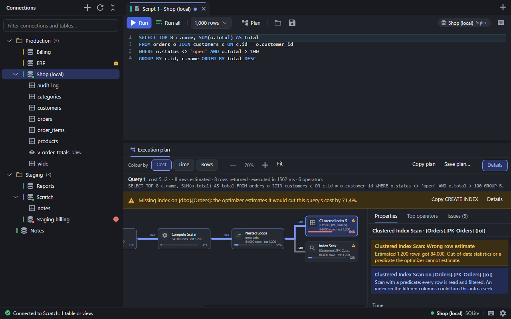
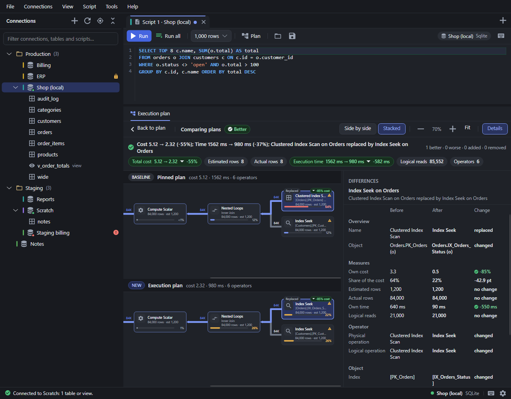

# Execution plans and statistics

Execution plans (estimated and actual, with a canvas, an issues list and a before/after comparison) and SQL Server
execution statistics, both from the toolbar of a script tab.

## Execution plans

The script toolbar has a **Plan** button (`Ctrl+L`) and an **Actual plan** switch (`Ctrl+M`), like SSMS:

- **Estimated plan** (`Ctrl+L`): the plan the optimizer would use for the selection or the statement at the caret. Nothing is run,
  so it is allowed on a read-only connection, even for a write statement. SQL Server: `SET SHOWPLAN_XML`. PostgreSQL:
  `EXPLAIN (FORMAT JSON)`. SQLite: `EXPLAIN QUERY PLAN` (no cost or row counts: a tree of scans and searches).
- **Actual plan** (switch on, then run as usual): the statements run, the rows stay in their tabs, and an **Execution plan**
  tab is added with the real row counts and times. SQL Server: `SET STATISTICS XML` (the rows past the row limit are read
  and dropped so that the plan, which the server sends last, is received). PostgreSQL: `EXPLAIN (ANALYZE, BUFFERS)`, which
  runs the statement but does not return its rows. SQLite has no actual plan.

The plan tab, one chip per statement when a run has several (with its share of the batch):

- **Canvas**: the root on the left, data flowing right to left, one card per operator (icon of its family, object, rows
  actual / estimated, a cost bar and its share of the statement). Arrows are as thick as the rows they carry and show the
  count; the path from the selected operator to the root is lit. Colour the bars by **Cost**, **Time** or **Rows**.
  Click to select, arrow keys walk the tree, the mouse wheel (or `Ctrl +` / `Ctrl -`) zooms around the cursor, `Ctrl+0` or
  **Fit** shows it all. It is a free canvas: drag the background (or `Shift+wheel`) to pan, well past the edges of the plan, so
  any operator can be brought to the middle; a part of the plan area always stays on screen. It opens on the costliest operator.
- **Properties**: everything the server says about the selected operator (costs, rows, times, I/O, object, predicates, seek
  predicates, output columns, buffers...) plus the statement's own (parallelism, memory grant, parameters, timings).
- **Top operators**: the costliest first; a click finds it in the plan.
- **Issues**: the warnings (spills to tempdb or disk, no join predicate, missing statistics, implicit conversions), the
  operators whose row estimate is 10 times off (where the error starts, not every operator above it), scans that an index
  could turn into seeks, key lookups, and SQL Server's **missing index** hints with a ready `CREATE INDEX` (**Copy**).
- **Copy plan** and **Save plan...**: the plan as the server sent it. A SQL Server `.sqlplan` opens in SSMS.

**Comparing two plans** (before and after an index or a rewrite):

- **Pin plan** keeps the plan on screen as the baseline of the script tab. A run clears the result tabs, but the pinned plan
  stays: after the next run, **Compare with...** offers "Pinned plan" first. The menu also lists the other statements of the
  tab. Without a pinned plan it says how to get one.
- The comparison replaces the plan view (**Back to plan** returns): the baseline above (or on the left, **Side by side**) and
  the new plan below, with the same cards. Operators are matched by structure (same operator on the same table first, an
  index change counts as the same operator replaced), so every matched card carries a badge (`-85% cost`, `-550 ms`), an
  operator that only exists on one side gets a dashed outline and an **Added** / **Removed** tag, and a scan turned into a
  seek is tagged **Replaced**.
- The header says it in words ("Cost 5.12 -> 2.32 (-55%); Clustered Index Scan on Orders replaced by Index Seek on Orders") and
  shows the figures as chips: total cost, rows, execution and planning time, logical reads, operator count. Green with a
  check or a down arrow is better, red with a warning or an up arrow is worse, a change of 10% or less is "no change"; row
  counts are neutral. Colour is never the only signal: every chip and badge has an icon and a figure.
- Click an operator on one side and its counterpart is selected on the other; **Differences** lists the name, object, cost,
  share, rows, time, reads and every property that changed (before, after, change). Metrics a plan does not report are
  skipped, so plans of different engines compare as far as they have figures in common.

Plans are per run and not run on a group. The `Time` colouring needs an actual plan. The SQL Server parser reads the
standard showplan XML by local names (any schema version) and skips what it does not know.

## Execution statistics

SQL Server script tabs have a **Statistics** check box in the toolbar (hidden for PostgreSQL and SQLite). With it on, the
next runs send `SET STATISTICS IO ON; SET STATISTICS TIME ON` on the tab's connection before your statements and
`... OFF` after them (a session setting sent as commands, not added to your text: the read-only guard, the statement
split and an open transaction are unaffected, and no option is left on the reused connection). The server messages are
captured per statement (`InfoMessage`; errors still fail the statement exactly as before) and two tabs appear after the
statement tabs, replaced by each run: **Statistics** and **Messages**. With the box off nothing is captured and nothing
changes. The box is per tab and not remembered across restarts.

**Statistics** is one grid, sortable by a click on a header (numbers by value, NULL last):

| Column | Content |
| --- | --- |
| `Database` | only in a group run: the member the row comes from |
| `Statement` | 1-based position of the statement in the run |
| `Kind` | `IO` (one table), `Parse/compile` or `Execution` (STATISTICS TIME), `Total` (sums of the statement), `Grand total` (sums of the run, or of the database in a group run; only when more than one statement has statistics) |
| `Table` | the table of an `IO` row (`Worktable`, `#temp` tables included) |
| `Scan count`, `Logical reads`, `Physical reads`, `Read-ahead reads`, `LOB logical reads`, `LOB physical reads`, `LOB read-ahead reads` | the IO counters (four page-server columns follow only when one of them is not 0, i.e. on Azure Hyperscale) |
| `CPU ms`, `Elapsed ms` | the TIME values (empty on `IO` rows) |

A stored procedure reports each inner statement and then the call itself, so its `Total` time can exceed the wall-clock
time. **Messages** lists every line the server sent (`PRINT`, warnings, the statistics lines), one per row, with the
statement number and the time; "Copy value" in the cell menu copies a whole line.

The server writes these lines in the language of the login (English, French, ...). They are read **by structure**, not by
keyword: a table name between quotes followed by 7 (older servers) or 11 counters, and two `= N ms` values for the times
(only the parse/compile versus execution split looks at words: English and French, else execution). A line that does
not match stays a plain message; nothing is ever dropped or raised.

**Run on group** honours the check box: every database sets the options on its own read-only connection and the extra
**Statistics** tab has a leading `Database` column, so the IO of the databases can be compared side by side. A write
statement is still refused before any database is contacted.

Limits: SQL Server only. A result cut at the row limit cancels its command, so the lines the server would have sent at the
end of that statement are lost; a cancelled statement yields none. `SET STATISTICS ...` typed in the script itself keeps
working as before but is only captured when the check box is on. The `DBX_MSSQL` integration tests check the capture and
the French messages against a real server ([Integration tests](development.md#integration-tests-against-real-databases)).
