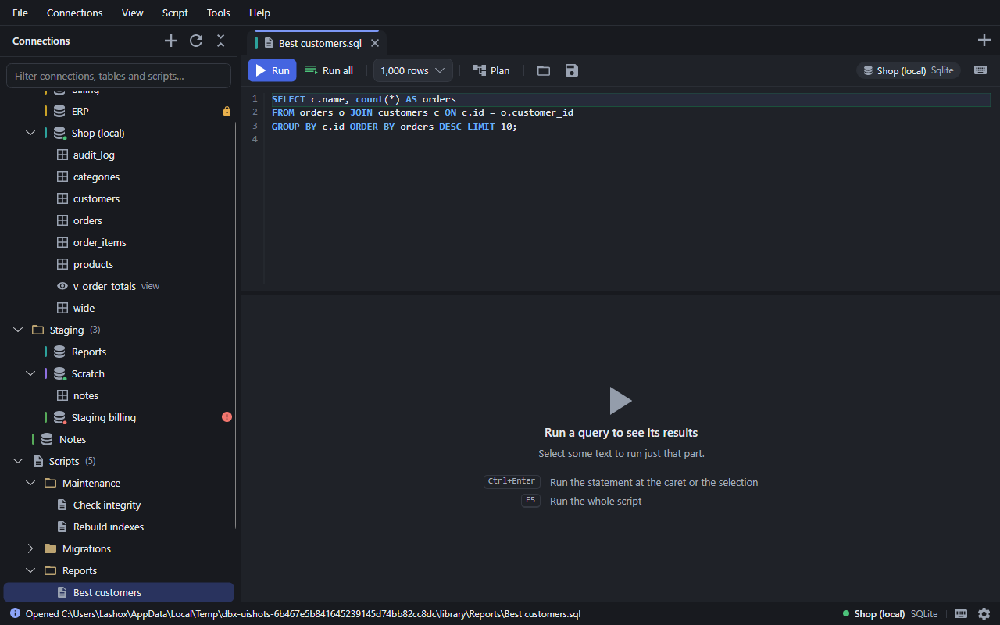

# Scripts

Scripts are plain `.sql` files. This page covers keeping them (the library), finding what you ran (the history), laying
them out (the formatter) and searching them. Running them, one connection per tab and restoring tabs are in
[Features](features.md#script-runner).

## Script library

Scripts you keep live in a **library**: plain `.sql` files in `%APPDATA%\dbExplorer\library\`, organised in real
sub-folders (any depth). Nothing is stored twice: a script tab simply points at its file, so saving, autosave and "open in
Explorer" work like for any file. The **Scripts** section of the navigator (View > Show scripts) lists it, folders first,
names in natural order (`q2` before `q10`).

- **Open**: double-click or `Enter` on a script. It opens on the active (or last selected) connection; a script that is
  already open just gets its tab back.
- **Save**: `Ctrl+S` on a script that was never saved asks for a **name and a library folder** (with **New folder...**); a
  name that exists is never overwritten (`name (2).sql`). **Choose another location...** uses the system file dialog, as does
  File > **Save script as...** at any time. A script that already has a file keeps saving silently to it.
- **Organise** (right-click, `F2` rename, `Delete`): rename, duplicate, move to a folder (or drag it onto a folder), delete (asks;
  a folder says how many scripts it holds; files are deleted for good), new script / new folder here, copy path, show in
  Explorer, refresh, open the library folder. Names cannot contain `\ / : * ? " < > |` or `..`; nothing leaves the library
  folder and a move or rename never overwrites. An open tab follows its file when it is renamed or moved.
- **Recent scripts**: File > **Recent scripts** lists the last 20 scripts opened or saved (library or not), most recent
  first, the full path as tooltip; files that are gone are dropped. Kept in `recent-scripts.json`.
- The navigator filter box also matches script names.

## Query history

Every statement you run from a script tab is recorded (when it ran: the failed or read-only-refused one is recorded with its
error, an estimated plan is marked as such). `Ctrl+Shift+H` or View > Query history opens the window:

- a search box that filters live on the SQL and the connection name, and the chips **All**, **Errors** and **This connection**
  (the connection of the active tab);
- the list, newest first: connection colour chip, two-line SQL preview, time ago (exact time in the tooltip), duration, rows, a
  *Failed* badge, an *Estimated / Actual plan* badge;
- the full statement and the error on the right, with **Copy SQL** and **Delete**; **Open in new tab** (`Enter`, double click)
  opens it on its connection (on the active one when that connection was deleted), **Run again** opens it and runs it;
  **Clear all…** asks before deleting everything. `Down` goes from the search box to the list, `Delete` removes the entry, `Esc` closes.

The history is a plain JSON-lines file (`history.jsonl` in the data folder), read only when the window opens, capped at the latest
5,000 statements; a statement longer than 20,000 characters is cut with a marker. A damaged line is skipped, an unwritable file only
means nothing is remembered. Tools > Settings > **Query history** switches the recording off (`RecordHistory` in `config.json`) and has a "Clear history" button
(asks for a second click; shows the number of entries and the file size).
Group runs (one statement on every database) are not recorded.

## SQL formatting

`Ctrl+Shift+F`, the toolbar button next to Save and **Script > Format SQL** format the selection, or the whole script when
nothing is selected. It is one edit of the editor: `Ctrl+Z` brings the old text back in a single step, and the caret stays on
the token it was on. The formatter is our own (no dependency) and built to be safe:

- it only moves whitespace and, optionally, changes the case of keywords. Strings, quoted identifiers (`"x"`, `` `x` ``, `[x]`),
  comments (a trailing `-- note` stays at the end of its line), `$$ ... $$` bodies, `GO` lines, `;`, variables (`@x`, `:x`,
  `$1`), operators and numbers are never rewritten. Function names and identifiers keep their case (SQLite names an
  unaliased column after its text);
- every statement is re-read after formatting and compared token by token with the original. A difference, or a character the
  lexer cannot classify, leaves that statement as it was; statements it does not lay out (`DECLARE`, `ALTER`, procedures,
  anything unknown) only get their runs of spaces collapsed and keywords cased, line breaks and indentation stay;
- formatting twice gives the same text.

Layout: one clause per line (`SELECT`, `FROM`, `WHERE`, `GROUP BY`, `HAVING`, `ORDER BY`, `LIMIT`, `UNION`...), the select
list one item per line when there are several, `JOIN ... ON` with the condition on an indented line, `AND` / `OR` at the start of
a line, subqueries and CTEs as indented blocks, `CASE WHEN ... THEN ... END` on separate lines, `INSERT ... VALUES`, `UPDATE ... SET`,
`DELETE`, `MERGE` and `CREATE TABLE` (one column per line) laid out the same way, short lists (`IN (1, 2, 3)`, function calls)
kept on one line and long ones wrapped at 100 columns. The rules follow the tab's engine (`TOP` on SQL Server, `RETURNING`
and `::` on PostgreSQL, `GO` lines on SQL Server).

**Tools > Settings > SQL formatting** sets the keyword case (upper, lower, as typed), the indent (2, 4, 8 spaces or a tab) and
the comma position (end or start of the line) and the maximum line width, with a live preview. They are saved in `config.json` (`Format`).

## Search in scripts and data

`Ctrl+Alt+F` (or View > Search in scripts and data…) opens one search overlay with two scopes. Enter searches, the arrow keys
select a result, Enter opens it, Esc closes (the last results are shown again the next time).

- **Scripts**: full-text search in the open script tabs (their current, possibly unsaved text, marked *unsaved*) and in every
  `.sql` file of the script library. Options: match case (`Aa`), whole word (`ab`), regular expression (`.*`; an invalid pattern
  is explained under the box, and a pattern that backtracks for more than a second on a line gives up on that line). Files over
  5 MB, binary and unreadable files are skipped and counted in the status line. Results stream in, grouped by script, at most
  2,000 matches (then a "more results are not shown" notice). A result opens the script at that line with the match selected.
- **Data**: finds a value in the data of a connection (connected on demand): match mode *Contains* / *Is exactly* / *Starts with*,
  an optional schema and an optional table-name filter. Each table is read once with a bounded, read-only, parameterised query
  (text columns, and number, GUID and date columns the text can match, compared as text; binary columns are never read; views
  are skipped), up to 4 tables at a time, 20 rows per table, a table that takes more than 2 minutes is abandoned and listed.
  The status line shows the progress ("table 12 of 140") and Stop ends the search keeping what was found. A result shows the row
  (key and leading columns, the matching cell in bold); it opens the table filtered on that column and value. Searching a large
  database can take a while: the overlay says so.
