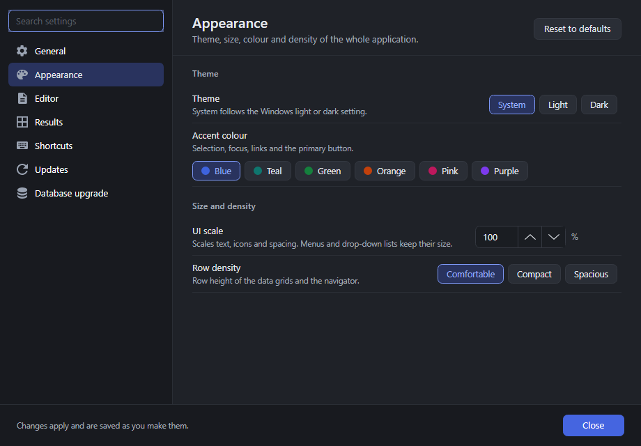

# Settings and data files

The Settings dialog, where dbExplorer keeps its files, and the command line and environment options.

## Settings

Tools > **Settings...** (`Ctrl+,`, also the gear button). A left list of pages, a search box that filters the settings by
label, and no OK / Cancel: every change applies at once and is saved in `config.json` (section `Settings`; an older file
without it means the defaults). **Reset to defaults** works per page. When the config could not be read at start-up the
status bar says the setting is not saved (it still applies for the run).

| Page | What it sets |
| --- | --- |
| General | Navigator: folders, Groups section, Scripts section (same flags as the View menu) |
| Appearance | Theme (System / Light / Dark, live), UI scale 90 to 150 %, accent colour (blue, teal, green, orange, pink, purple, both themes, button text keeps 4.5:1), row density (Comfortable 28 / Compact 24 / Spacious 32 px) |
| Editor | Font family (installed code fonts) and size 10 to 24, line numbers, word wrap, show whitespace, current line highlight, [closing brackets and quotes](scripts.md#typing-in-the-editor) (on by default), tab size 2 / 4 / 8. Open editors follow at once |
| Results | Grid font size, alternate row shading, default row limit of new scripts, NULL text (`NULL`, `(null)`, empty), thousands separator, date format (ISO or locale), longest cell text. Display only: filters, sorting, copy and edits keep the plain values |
| Query history | Record the query history on or off, **Clear history** (confirmed), entry count and file size |
| SQL formatting | Keyword case, indent (2, 4, 8 spaces or tab), comma position, maximum line width, live preview of a sample statement |
| Shortcuts | Every shortcut (from the same list as F1) with a filter box and **Copy as markdown**. Read only |
| Updates | Automatic update check |
| Database upgrade | The dbupdate folder (see [Database upgrade](database-upgrade.md)) |

The saved theme, accent and scale are applied before the first paint from the config that is already loaded (no extra file
read); default settings change nothing at start-up. The UI scale is a layout transform around each window's content, so
menus, drop-down lists and tooltips (separate windows) keep their size.

## Configuration and data

Everything lives in `%APPDATA%\dbExplorer`:

| Path | Content |
| --- | --- |
| `ssh_known_hosts.json` | SSH host key fingerprints accepted in the trust question, one per server ([SSH tunnels](features.md#sign-in-and-ssh-tunnels)) |
| `config.json` | folders, connections (passwords, client secrets and SSH secrets DPAPI-encrypted for the current Windows user), virtual keys, linked groups, the automatic-update setting, the dbupdate folder (`DbUpdatePath`, empty = upgrade off), the SQL formatting style (`Format`), the query-history switch (`RecordHistory`), the recently used palette commands (`RecentCommands`), the copy and export choices (`Export`), the Settings dialog values (`Settings`) |
| `cache\` | per-connection metadata cache (schema/table/column names) used by `Ctrl+Shift+P` |
| `scripts\` | unsaved script tabs, restored at the next start |
| `library\` | the script library: your saved `.sql` scripts and their folders ([Script library](scripts.md#script-library)) |
| `recent-scripts.json` | the last 20 scripts opened or saved |
| `history.jsonl` | the query history, one JSON line per statement, latest 5,000 ([Query history](scripts.md#query-history)) |
| `window.json` | size, position and maximised state of the main window |
| `session.json` | the open tabs (order, active tab, table filters / WHERE / sort, script files); delete it to forget them (only unsaved scripts then come back) |

A corrupt `config.json` is moved to `config.json.bad-<timestamp>` and the app starts empty with a notice. If the file
cannot be read at all (locked, unreadable) the app starts in read-only-config mode: a red banner says so and nothing is
ever written to it (`session.json` is then neither read nor written either). A corrupt `session.json` is moved to
`session.json.bad-<timestamp>` the same way, with a notice, and the app starts with no tabs from it (the unsaved scripts
still come back). A `session.json` that exists but cannot be read (locked) is not restored and not written for that run, so
it cannot be overwritten; the same holds in read-only-config mode.

## Command line and environment

| Option | Environment variable | Meaning |
| --- | --- | --- |
| `--data-dir <path>` | `DBEXPLORER_DATA_DIR` | Use this folder instead of `%APPDATA%\dbExplorer` |
| `--dbeaver-dir <path>` | `DBEXPLORER_DBEAVER_DIR` | DBeaver config folder for the import. When only the data dir is overridden it defaults to `<data dir>\dbeaver`, never the real workspace |
| | `DBEXPLORER_RENDERING=gpu` | Use Avalonia's default GPU/ANGLE rendering instead of software rendering (see [Startup performance](development.md#startup-performance)) |
| `--no-update-check` | `DBEXPLORER_NO_UPDATE_CHECK=1` | Do not look for a newer release in the background for this run (see [Automatic updates](install.md#automatic-updates)) |

A flag without a value is reported in a message box and the app exits (exit code 2). The flags win over the environment
variables.
